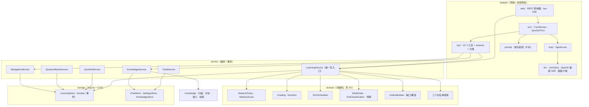

# MasteryPath（精通之路）

> 以知识地图为中心的掌握式学习智能体。
> 一条学习目标 → 一份可编辑的知识地图 → 逐个知识点「讲 → 考 → 判 → 复习」，
> 外加一个可以随时开刷的题库与练习卷。

**核心设计原则：教学交给模型，推进交给引擎。**
导师（LLM）决定讲什么、怎么问；「是否掌握、能否推进」由确定性规则裁决，模型无权放行。

---

## 目录

1. [它解决什么问题](#1-它解决什么问题)
2. [功能地图](#2-功能地图)
   - [2.1 掌握之路（主功能）](#21-掌握之路主功能)
   - [2.2 刷题与题库](#22-刷题与题库)
   - [2.3 知识库与来源](#23-知识库与来源)
   - [2.4 普通聊天与导航](#24-普通聊天与导航)
   - [2.5 设置中心](#25-设置中心)
3. [技术架构](#3-技术架构)
4. [快速开始](#4-快速开始)
5. [第一次使用：10 分钟走通](#5-第一次使用10-分钟走通)
6. [运行、数据与备份](#6-运行数据与备份)
7. [验证与测试](#7-验证与测试)
8. [目录结构](#8-目录结构)
9. [工程约定](#9-工程约定)
10. [边界与已知限制](#10-边界与已知限制)
11. [常见问题](#11-常见问题)

---

## 1. 它解决什么问题

自学卡住的通常不是"没有资料"，而是三件事：

| 卡点 | 具体表现 | 本项目的回答 |
| --- | --- | --- |
| 路径不清 | 收藏了一堆资料，不知道从哪开始 | 把目标拆成**可编辑的知识地图**（模块 + 知识点） |
| 判据缺失 | 看完了感觉懂了，一合上书就忘 | **确定性判分 + 类型化掌握门槛**，不靠自我感觉 |
| 学完即忘 | 没有复习节奏，学过的慢慢消失 | **SM-2 间隔复习**，到期自动重现 |

它不做通用的"什么都能聊"，只做一条闭环：**地图 → 学习 → 检验 → 复习**。

---

## 2. 功能地图

```
掌握之路（主功能）                     刷题（并行的第二条动线）
├─ 知识地图（大纲）                    ├─ 题库（来自历次作答）
├─ 三种模式（大纲/学习/复习）          ├─ 标签、检索、按知识库分组
├─ 四类知识点 + 掌握门槛              ├─ 刷题器（即时判分，不改掌握）
├─ 掌握之路会话（讲→考→判）           └─ 练习卷（一次生成 1–10 题）
├─ 间隔复习
└─ 缺口、画像、导航 hand-off
```

两条动线**共用题库与知识库**，但掌握分数只由「掌握之路」产生——刷题和练习卷都不写掌握分。

### 2.1 掌握之路（主功能）

入口：`/learning/mastery`（主题图集）→ `/learning/mastery/{pathId}`（目标仪表盘）→
`/learning/mastery/{pathId}/sessions`（学习工作区）。

#### 学习闭环


#### 三种模式（后端硬门控）

| 模式 | 能做什么 | 不能做什么 | 准入条件 |
| --- | --- | --- | --- |
| `outline` 大纲 | 生成 / 修订知识地图、处理缺口 | 出题、判分 | 无 |
| `study` 学习 | 讲解、出题、判分、定性评估、暂缓、修复坏题 | 改地图 | **路径必须已有大纲** |
| `review` 复习 | 重测**已掌握**的知识点、重排复习 | 教新内容、考未掌握点 | 无 |

门控在**工具调用期**校验（不是前端禁用按钮）：越权调用会被拒绝并提示正确模式；
工具若未在分类表中登记，服务**启动即失败**（fail-closed）。

#### 四类知识点，类型决定"什么叫会"

| 类型 | 掌握证据 | 判定方式 | 典型活动 |
| --- | --- | --- | --- |
| `memory` 记忆 | 准确复述 / 默写 | **量化**：近期加权正确率 ≥ 0.9 | 闪卡、填空、选择题 |
| `procedure` 程序 | 按步骤执行、能处理分支 | **量化**：同上 | 分步演练、错题重做 |
| `concept` 概念 | 用自己的话解释、举例、建立联系 | **定性**：费曼式讲解通过 | 讲解、对比辨析 |
| `design` 设计 | 约束下做取舍并说明理由 | **定性**：同上 | 方案设计、权衡分析 |

量化的细节：取最近 **5** 次独立作答，权重由旧到新为 `0.5 / 0.7 / 0.85 / 0.95 / 1.0`；
有效样本只有 1 次时分数上限 0.5、2 次上限 0.8，避免"两次满分就通关"。类型创建后只读。

#### 判分规则（零模型调用）

| 题型 | 判定 | 兜底 |
| --- | --- | --- |
| `choice` 选择 | 按标签或归一化正文匹配；歧义视为解析失败 | 解析失败 → **未判分** |
| `short` 短答 | 精确 → 可接受答案 → 数字相对误差 `1e-6` → 相似度 ≥ 0.90（超过 30 字符只做精确匹配） | 同上 |
| `open` 开放 | 必选关键词全中 + 可选关键词命中率 ≥ 0.60 | 同上；**判对也只记部分正确** |

- **未判分（ungraded）**：零状态变更、题卡保留、要求学习者澄清；判不了就不判，绝不判错。
- **有提示的正确**：降为部分正确，避免"提示出来的掌握"。
- 重复提交同一题：返回首次结果（幂等），不重复记账。

#### 双轨进度：系统判定 vs 学习者声明

| 来源 | 怎么产生 | 写掌握分数？ | 复习播种 |
| --- | --- | --- | --- |
| `system` | 判分跨过门槛 / 定性评估通过 | 是 | 首次间隔 1 天 |
| `learner` | 学习者主动声明"这个我会" | **否**（只推进地图） | 首次间隔约半天，更快被验真 |

两条来源分别记录，复习调度区别对待；声明不会留下掌握证据。

#### 间隔复习（SM-2）

- 间隔序列：1 天 → 6 天 → `round(上次间隔 × 易度因子)`；易度因子初值 2.5、下限 1.3。
- 失败（质量 < 3）：回到 **10 分钟**重学，并标记"锚点由失败设置"。
- 复习只巩固、**不推进前沿**；到期是提醒，不是许可。

#### 大纲、缺口与覆盖

- **生成**：`mastery_build` 提交模块与知识点（含类型、来源）；非空路径重建必须显式确认，否则列出将丢失的内容并拒绝。
- **修订**：`mastery_revise` 用差分 `ops` 改地图，未触动的知识点保留进度；已掌握的知识点拒绝重写。
- **缺口**：`来源遗漏`（资料没被用上）与 `目标缺口`（知识点无来源支撑）；必须显式处理（接受 → 标记未接地 / 补充来源 / 重新生成），不允许静默丢弃。
- **覆盖报告**：文档数、被覆盖数、遗漏清单、接地率、前置图是否有环。

#### 题卡与练习卷（两种"做题"）

| | 掌握题卡 | 练习卷 |
| --- | --- | --- |
| 触发 | 导师在 `study`/`review` 中出题 | 学习者主动请求（`deep_question`） |
| 规模 | 一次一道，**单槽位**（已有未答题则重放同一张） | 一次 1–10 题 |
| 回合语义 | **出题即结束回合**，作答是下一条消息 | 一次生成、整卷提交 |
| 影响掌握 | 是（判分写入证据与掌握度） | **否**（独立表，不写证据） |
| 答案可见性 | 投影不含答案与解析 | 提交前不含答案，提交后才释放 |

练习卷提交时若任一题"未判分"，整卷**零状态变更**并返回原因；已提交的卷幂等。

### 2.2 刷题与题库

入口：`/space` → 「题库」Tab（另有「历史对话」「知识库」两个 Tab）。

**题库从哪来。** 掌握之路里每道题判分后，会连同题面、选项、答案、解析、难度、题型、
来源与所关联的知识点写入题库；答错的历史会被保留，用于回看与重刷。

**题库能做什么。**

| 能力 | 说明 |
| --- | --- |
| 检索 | 多标签取**交集**、关键词匹配、多知识库取**并集**；也可按知识库分组浏览 |
| 标签 | 手动打标、批量打标、标签重命名 / 合并 / 删除 |
| 刷题器 | 只抽**可确定性判分**的题；默认 10 题、上限 50；排序 `newest` / `wrong_first` / `random` |
| 即时反馈 | 作答后立即判分并显示答案解析；只回写该题的作答记录 |
| 与掌握的关系 | **不改掌握度、不写证据、不进复习队列**——刷题是练习，不是通关 |

**练习卷与刷题的区别。** 刷题从题库抽已有题；练习卷按当前主题的知识点**现生成**新题
（`deep_question`），提交后逐题判分并给解析，同样不计入掌握。

### 2.3 知识库与来源

- 支持两种接入：**导入**（文件复制进 `data/knowledge_bases/<id>/raw/`）与**链接**（只记录本地文件夹路径）。
- 扫描 `.txt` / `.md` / `.markdown`，跳过隐藏目录与 `.git` / `node_modules` 等；每个文件登记为一条来源。
- 索引：按字符窗口分块（默认 512 / 重叠 64）+ 调用嵌入模型，落到 `index/chunks.json`；检索为余弦相似度 top-k。
- 状态：`empty` / `rag_prerequisite_missing` / `indexing` / `ready` / `error`；未配置嵌入模型时仍可建库，但检索返回空。
- 一个主题可绑定**多个**知识库；题目按"所属主题绑定了哪些库"派生归属，因此同一题可出现在多个库视图下。

### 2.4 普通聊天与导航

- `/chat`：通用对话，走 SSE；只挂 4 个只读导航工具（列主题 / 列会话 / 打开会话 / 新建会话）。
- 导师可以生成 **hand-off 卡片**（主题、模块、掌握数、到期数、可编辑开场语），但**不能自动跳转**；
  是否进入学习工作区由学习者点击决定。

### 2.5 设置中心

`/settings/{section}`，固定六个分组：

| 分组 | 内容 |
| --- | --- |
| `general` | 界面语言、回复语言 |
| `providers`（前端 `connections`） | 提供方名称、地址、密钥、协议（`openai` / `anthropic` / `ollama` / `custom`） |
| `llm` | 主模型（对话 / 出题 / 定性评估） |
| `task-models` | 任务模型（建议下一问、会话命名），未配置时确定性回退 |
| `embedding` | 嵌入模型（知识库检索） |
| `indexing` | 分块大小与重叠 |

「测试连接」只拉模型列表，**不发起计费推理**；向量维度探测需手动点击（会产生一次很小的嵌入调用）。

---

## 3. 技术架构

### 3.1 分层与依赖



硬约束：**`adapter → service → domain`** 单向依赖；`domain` 不依赖 Spring、不做 I/O、`now` 显式传入，
因此判定可以离线、逐值断言。`storage` 只被 `service` 与设置相关控制器使用。

### 3.2 五个关键机制

**① 单聚合 + 版本 CAS（写一致性）**

一条学习路径的全部状态（地图、掌握度、证据、复习队列、缺口、待答题）序列化为一行的 JSON，
`paths.version` 做乐观锁。所有写入都必须经过 `LearningStore.mutate`：

```
读 (version, data) → 反序列化 → 就地修改 → UPDATE ... WHERE path_id=? AND version=?
   └─ 冲突：抛 CasConflictException，抖动退避重试 ≤3 次
   └─ 成功：事件以本次新 revision 批量落库；失败整体回滚
```

一次工具调用 = 一次写事务。其余 7 张表（事件、题目事务、题库、会话、消息、题卷、题目）都是**旁路**：
可从聚合重建，但从不反向写回。

**② 回合协议（读侧与写侧分离）**

一轮导师对话只走 WebSocket（`/ws`），其余操作走 REST；普通聊天走 SSE。

事件顺序固定：`text_delta*` → `tool_call` → `tool_result` →（`question_card`）→ `turn_end` →
（`session_meta`，仅模式/路径变化时）→ 落库。

三条不可调换的顺序：

1. 携带作答的回合**先判分**，再把 `tool_result` 交给模型——模型看不到未判分的答案。
2. `question_card` 是 `tool_result.metadata` 的**投影**，不是 Loop 的产出；投影剔除答案与分析。
3. `session_meta` 必须在 `turn_end` **之后**、落库之前推送。

失败路径：保留已产出的文本与题卡 → 发 `error(code, retryable)`，不发 `turn_end`
（题卷路径例外：`error` + `turn_end(error)`）。正常结束原因有四种：`done` / `card` / `budget` / `max_rounds`。

**③ 智能体：循环、工具与预算**

- `AgentLoop`：单回合 ≤6 轮、≤6 次工具调用；未知工具 / 参数解析失败 / 工具异常都只返回 `ok=false`，不杀死回合。
- 工具共 **23 个**：大纲专属 2、学习与评估 9、三模式共享 12；`rag` 与 `read_source` 按条件挂载。
- 模式门控在调用期执行，分类表**静态且 fail-closed**；越权拒绝会提示正确模式。
- 行为预算：连续出题 ≤3、同题提示 ≤2。
- 上下文装配：系统提示 8 块（导师 → 模式 → 运行时 → 政策 → 回合协议 → 教学 playbook → 预算 → 工具清单）
  + 状态快照 + 最近 6 张卡复盘 + ≤20 条历史 + 知识库参考块。

**④ 确定性判定**

判分、掌握门槛、下一路标、模式门控、复习排期、题目投影全部是纯函数；供应商差异收敛在 `adapter.llm`。
测试用脚本化假客户端，可完全离线运行并断言"模型实际看到的工具表"。

**⑤ 两层门控**

| 层 | 在哪 | 拦什么 |
| --- | --- | --- |
| 会话准入 | 切模式时（`mastery_mode` / REST） | 学习模式要求已有大纲 |
| 调用期门控 | 每次工具调用 | 该工具是否属于当前模式；未归类工具启动即失败 |

### 3.3 数据与存储

| 位置 | 内容 | 说明 |
| --- | --- | --- |
| `data/learning.db` | `paths`（真相）· `events` · `interactions` · `question_bank` · `sessions` · `messages` · `quiz_sets` · `quiz_items` | SQLite，WAL，单写者 |
| `data/chat.db` | 普通聊天的会话与消息 | 与学习库分开，可独立删除 |
| `data/settings.json` | 提供方、模型、语言、分块 | **含明文密钥**，已在 `.gitignore` |
| `data/knowledge_bases/<id>/` | `kb.json` · `raw/` · `index/chunks.json` | 原始文档保持人类可读 |

聚合字段（节选）：`modules`、`knowledgeTypes`、`masteryLevels`、`qualitativeMastery`、
`quizAttempts`、`learningEvidence`、`repetitionStates`、`reviewQueue`、`learnerMasteryOverrides`、
`deferredObjectives`、`sourceGaps`、`proposals`、`coverage`、`pendingQuestion`、`version`。

### 3.4 接口速览

| 通道 | 端点 | 用途 |
| --- | --- | --- |
| WS | `/ws` | 掌握之路回合；一次连接一条 JSON 请求 |
| SSE | `POST /chat/sessions/{id}/turns` | 普通聊天回合 |
| REST | `/learning/paths`、`/learning/paths/{id}`、`/learning/paths/{id}/map`、`/sessions` … | 路径、大纲、模式、复习、事件流 |
| REST | `/learning/paths/{id}/quiz-sets/{setId}` + `/submit` | 练习卷读取与提交 |
| REST | `/questions`、`/questions/search`、`/questions/practice`、`/questions/{entryId}/attempt` | 题库与刷题 |
| REST | `/knowledge-bases/**` | 知识库建档、导入、索引、进度 |
| REST | `/settings/**`、`/settings/providers/probe` | 设置与连通性探测 |

### 3.5 技术栈

| 项 | 选择 |
| --- | --- |
| 运行时 | Java 21（record / sealed / pattern matching） |
| 框架 | Spring Boot 3.5（web / validation / actuator） |
| 构建 | Maven Wrapper（仓库自带 `mvnw` / `mvnw.cmd`，无需预装 Maven） |
| 持久化 | SQLite（`sqlite-jdbc`，WAL，`busy_timeout=5000`）+ 手写 JDBC |
| JSON | Jackson（忽略未知字段，兼容历史数据） |
| 测试 | JUnit 5 + AssertJ + 脚本化假模型 |
| 前端 | Next.js 14（App Router）+ React 18 + Tailwind（语义色令牌） |
| 模型接入 | OpenAI 兼容协议（自写 SSE 解析与 `tool_calls` 拼装） |

---

## 4. 快速开始

### 4.1 环境要求

| 组件 | 版本 | 说明 |
| --- | --- | --- |
| JDK | 21+（实测 Temurin 21.0.11） | 含 `javac`；**不需要预装 Maven**，仓库自带 wrapper |
| Node.js | 18.17+（实测 24.18.0） | 仅前端需要 |
| Ollama（可选） | — | 知识库检索需要嵌入模型，如 `ollama pull bge-m3` |

### 4.2 启动后端

```powershell
# 项目根目录
.\mvnw.cmd spring-boot:run
```

默认监听 `http://127.0.0.1:8080`，数据目录 `data/`。

换端口 / 换数据目录（用环境变量，避免 PowerShell 下 `-D` 参数被吞）：

```powershell
$env:SERVER_PORT='8081'
$env:MASTERYPATH_DATADIR='tmpdata'
.\mvnw.cmd spring-boot:run
```

打包成可执行 jar：

```powershell
.\mvnw.cmd -q -DskipTests package
java -jar target\masterypath-0.1.0-SNAPSHOT.jar
```

连通性自检（返回 `200` 即后端可用）：

```powershell
curl.exe -s -o NUL -w "%{http_code}`n" http://127.0.0.1:8080/learning/paths
```

### 4.3 启动前端

```powershell
cd web
npm ci
$env:NEXT_PUBLIC_API_BASE='http://127.0.0.1:8080'
npm run dev
```

打开 `http://127.0.0.1:3000`。

> `NEXT_PUBLIC_API_BASE` **必须显式设置**，且设置后再启动 `npm run dev`（Next 在启动时内联该变量，运行中修改无效）。
> 未设置时默认指向 `http://127.0.0.1:8001`，会打不到本后端。WebSocket 地址由该变量自动派生（`http` → `ws`）。

### 4.4 配置模型

对话、大纲生成、建议下一问需要模型；**判分、门槛、门控、复习调度不需要**，所以不配模型也能跑「出题 → 作答 → 判分」。

**方式一：界面配置（推荐）**

1. `/settings/connections` → 「添加提供方」→ 填 `base_url` + `api_key` + 协议 → 「测试连接」；
2. 拉取或手动添加模型；
3. `/settings/llm` 把某个模型设为默认。

**方式二：直接编辑** `data/settings.json`

```jsonc
{
  "providers": [
    { "id": "p1", "name": "DeepSeek", "base_url": "https://api.deepseek.com", "api_key": "sk-...", "protocol": "openai" }
  ],
  "llm": { "models": [ { "id": "m1", "provider_id": "p1", "model": "deepseek-chat" } ], "active_id": "m1" }
}
```

**方式三：本地 Mock（仅开发，零依赖）**

```powershell
# 终端 A：假模型服务（127.0.0.1:9099）
node scripts/mock-llm/mock-llm.mjs

# 终端 B：后端
.\mvnw.cmd spring-boot:run
```

在 `/settings/connections` 添加提供方：`base_url = http://127.0.0.1:9099/v1`、`api_key = mock`、协议 `openai`，
测试连接后把模型 `mock-tutor` 设为默认。剧本是确定性的：

| 你说 | 结果 |
| --- | --- |
| `outline` 模式下「帮我规划大纲」 | 调用 `mastery_build`，生成 2 模块 4 知识点 |
| `study` 模式下「出题」 | 调用 `mastery_quiz`，弹出一道选择题卡片 |
| 「列出我的主题」 | 调用 `mastery_topics`（普通聊天链路） |
| 其他任何话 | 固定的 Markdown 流式回复 |

---

## 5. 第一次使用：10 分钟走通

1. **建主题**：`/learning/mastery` → 「新建主题」→ 填标题与目标（可顺带选知识库）。
2. **设计大纲**：进入工作区（默认 `outline`）→ 跟导师说「帮我规划大纲」→ 得到模块与知识点；
   不满意就继续说「把 X 拆成两个」；有缺口时逐条处理。
3. **开始学习**：切到 `study` → 追问题「下一步学什么」→ 导师讲解并出题（题卡出现在对话里）。
4. **作答**：点选项或在输入框作答 → 服务端**先判分**，再给反馈与解析。
5. **声明已会**：确实已掌握的知识点，可在仪表盘点「我已掌握」（只推进地图，不写分数）。
6. **到期复习**：仪表盘右栏出现到期项 → 切 `review` → 重测 → 间隔自动重排。
7. **刷题**：`/space` → 题库 → 按标签/知识库筛选 → 「开始刷题」（默认 10 题，即时判分）。
8. **生成练习卷**：在学习工作区请求「来一套 5 题的练习卷」→ 整卷作答 → 提交后看解析。

快捷键：输入框为空时按 **Tab** 采纳服务端建议的问题；发送前可自行改写。

---

## 6. 运行、数据与备份

| 事项 | 做法 |
| --- | --- |
| 端口 | 后端 `SERVER_PORT`（默认 8080）；前端 `npm run dev` 默认 3000 |
| 数据目录 | `MASTERYPATH_DATADIR`（默认 `data`），四个落点见 [3.3 数据与存储](#33-数据与存储) |
| 备份 | 停服务后复制 `data/` 即可；单文件数据库 + 人类可读的知识库目录 |
| 清空学习数据 | 停止后端，删除 `data/learning.db`（聊天另删 `data/chat.db`） |
| 重置设置 | 删除 `data/settings.json`，首次保存时会重新生成默认值 |
| 日志 | SLF4J + Logback；`verify.ps1` 的验证日志落 `artifacts/` |

> `data/settings.json` 中的密钥是**明文**，且 `GET /settings` 会原样返回；仓库已忽略该文件，不要提交。

---

## 7. 验证与测试

| 命令 | 作用 |
| --- | --- |
| `.\mvnw.cmd -q test` | 全量单元测试与契约测试 |
| `.\mvnw.cmd -q -DskipTests compile` | 只编译 |
| `.\scripts\verify.ps1 -Change <change-id>` | 唯一验证入口：跑测试、产出证据到 `docs/verify/` |
| `java -cp target\classes com.masterypath.cli.OutlineEvalCli outline --cases <jsonl>` | 大纲离线评测（KP 精确率 / 召回 / F1、数量有界、前置无环） |

当前基线：**93 个测试文件 / 864 条用例通过**；`docs/verify/` 下按 change 留存证据，
`docs/regression-log.md` 记录回归基线，`docs/verification-debt.md` 记录未跑项。

---

## 8. 目录结构

```
openspec/                  规范与变更的单一真实源（project.md / specs / changes）
docs/
  design/                  第二部分设计工件（设计摘要、架构、ADR、模型、UI/UX、风险…）
  verify/                  每个 change 的验证证据
  migration-plan.md        构建计划与 Gate 定义
  traceability.md          场景 ↔ 规范 ↔ 测试
src/main/java/com/masterypath/
  domain/                  模型 + 纯策略 + 判分 + 调度 + 门控（零 I/O）
  storage/                 SQLite + CAS + 事件
  service/                 业务编排（唯一写入口）
  adapter/                 LLM / Loop / TurnRunner / REST / WS / 工具 / 提示
  knowledge/               扫描、分块、嵌入、检索
  settings/                提供方探测
  cli/                     大纲评测命令行
src/main/resources/
  application.properties   端口与数据目录
  prompts/zh/              提示词包（mastery_loop.yaml / agentic_chat.yaml / hints/）
web/                       Next.js 前端（App Router）
scripts/
  verify.ps1               唯一验证入口
  mock-llm/                本地假模型服务（开发联调，零依赖）
```

---

## 9. 工程约定

本项目使用 OpenSpec + SDD（规格驱动）。开工前必读 [`openspec/AGENTS.md`](openspec/AGENTS.md)。

1. **不扩大范围**：顺手优化另开 change。
2. **不跳步**：Plan → Check → Build → Verify → Merge。
3. **不伪造证据**：`NOT RUN` 就是 `NOT RUN`，记入 `docs/verification-debt.md`。
4. **不放宽断言**：失败要么修实现，要么证明测试写错。
5. **不绕过变更改基线**：行为变化走增量规范，归档时合并。

硬性技术约束（摘要）：`domain` 零 I/O、零 Spring；写操作必须走 `mutate`；判分 / 门槛 / 门控 / 调度不得调用 LLM；
学习者可见投影不得含 `expected_answer` / `explanation`。

---

## 10. 边界与已知限制

| 限制 | 现状 | 影响 |
| --- | --- | --- |
| 单用户、无鉴权 | 默认仅监听本机，无账号体系 | 不能直接共享给他人使用；端口暴露即等于开放 |
| 密钥明文 | 存于 `settings.json` | 依赖设备本身的安全；不要提交到仓库 |
| SQLite 单写者 | 单进程 + 单连接写 | 无法水平扩展；多设备同步需要换存储 |
| 生成质量 | 依赖所选模型 | 大纲与题目质量波动，需要离线评测与人工校对 |
| 阈值未标定 | `0.9` / `0.90` / `0.60` / EF `2.5` 为默认先验 | 对个别学科可能偏严或偏松 |
| 定性评估 | 由模型判定，只对 `concept` / `design` | 同一解释两次评估可能不一致 |
| 练习卷/刷题不计掌握 | 与掌握证据物理隔离 | 用户可能误以为"做了题却没涨分"（界面已标注） |
| 暗色主题 | 令牌已定义，未提供切换入口 | 仅亮色可用 |

---

## 11. 常见问题

| 现象 | 原因 / 处理 |
| --- | --- |
| `Cannot find java` / `JAVA_HOME is set to an invalid directory` | `JAVA_HOME` 指向了不存在或过旧的 JDK。PowerShell 用 `$env:JAVA_HOME='C:\Program Files\Java\jdk-21.0.11'`，cmd 用 `set JAVA_HOME=...`（不加引号） |
| 前端页面空白、请求打到 8001 | 未设 `NEXT_PUBLIC_API_BASE`，或设置后没重启 `npm run dev` |
| 端口被占用 | `$env:SERVER_PORT='8081'` 后重启；前端同步改 `NEXT_PUBLIC_API_BASE` |
| 聊天回复为空 / 报模型错误 | `data/settings.json` 未配置默认模型，或密钥无效；到 `/settings/connections` 测试连接 |
| 知识库状态 `rag_prerequisite_missing` | 未配置嵌入模型；本地起 Ollama 并 `ollama pull bge-m3`，再到 `/settings/embedding` 选中 |
| 出题后刷新页面题卡不见了 | 题卡会写入会话历史；若仍缺失，检查该会话是否属于当前路径 |
| 学习模式提示"先设计大纲" | `study` 的准入条件是路径已有大纲；先在 `outline` 模式生成 |
| 判分显示"未判分" | 答案无法解析（空答 / 歧义 / 选项不匹配）；换一种说法再提交，系统不会判错 |
| 复习里看不到某个知识点 | 复习只重测**已掌握**的点；未掌握的先在 `study` 通过门槛 |
| 刷题没有可出的题 | 题库只保留可确定性判分的题；先去掌握之路做几道题 |
| `verify.ps1 --change xxx` 报参数错误 | Windows PowerShell 不识别 `--change`，用 `-Change xxx` |
| PowerShell 里中文变 `?` / 乱码 | PS 5.1 的 `Invoke-RestMethod` 会按系统代码页收发；改用 `curl.exe` 落文件，再用 `[System.IO.File]::ReadAllText($p, [Text.Encoding]::UTF8)` 读 |
