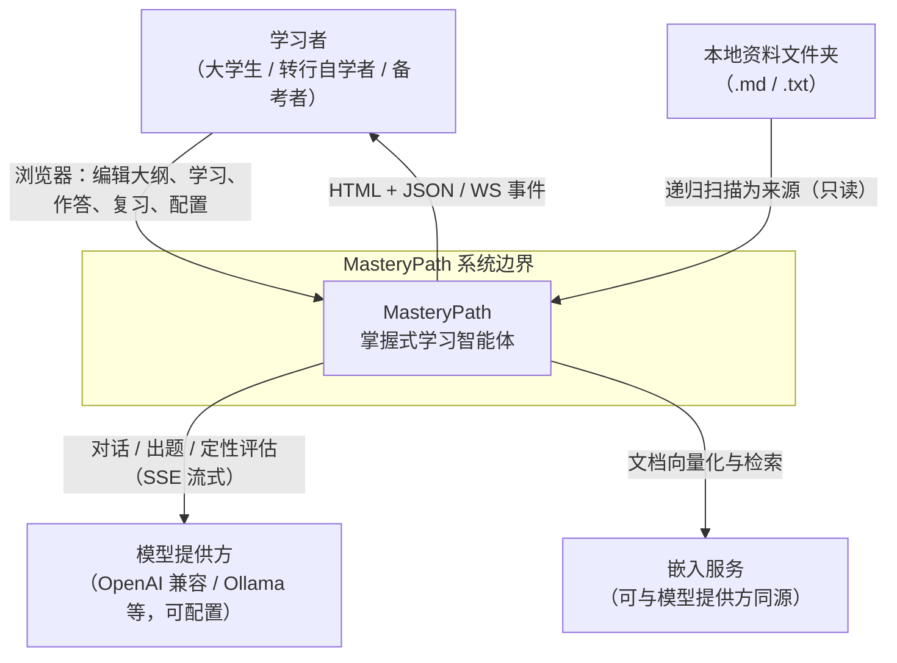
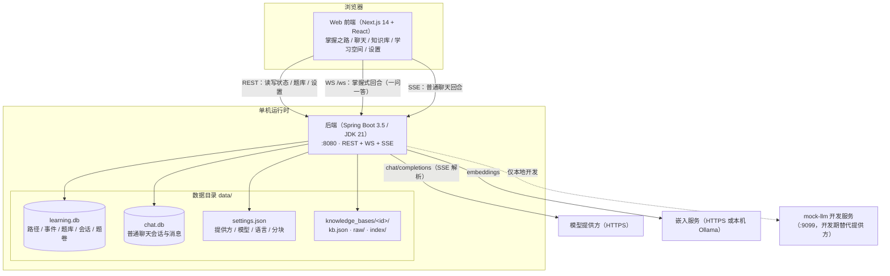
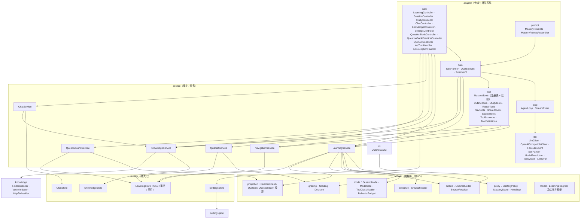
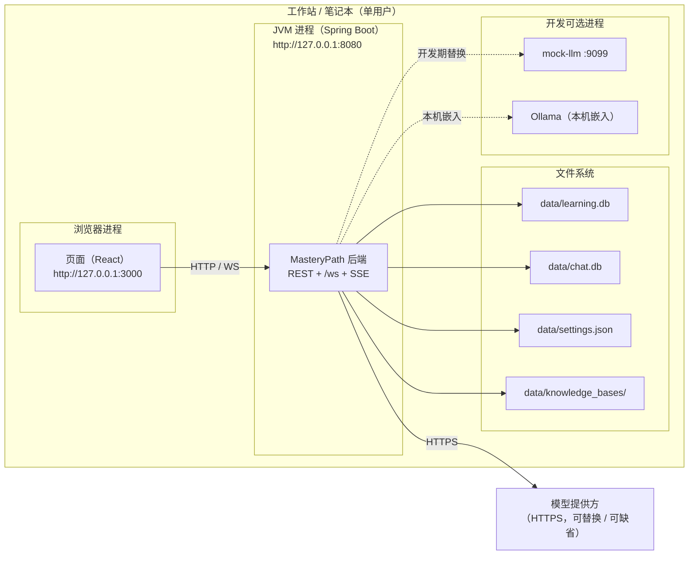
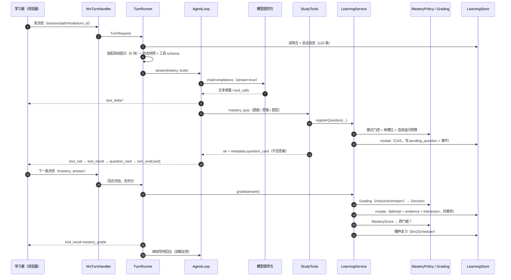

# 02 · 架构与关键决策

> 对应作业工件 2（架构部分）。关键取舍的理由单列在 [04-adr.md](04-adr.md)；智能体相关设计见 [03-agentic-design.md](03-agentic-design.md)。

## 1. 设计驱动：先把"什么最贵"排清楚

第一部分把产品定位为"以地图为中心、判定不被幻觉击穿"。落到架构上，真正昂贵的失败不是"答得不好"，而是四件事：

| 失败模式 | 后果 | 架构上的对策 |
| --- | --- | --- |
| 模型自称"你已掌握" | 整个产品的卖点归零 | 判定全部下沉到 `domain` 纯函数：判分 / 门槛 / 门控 / 调度零模型调用 |
| 泄题 | 练习失效、掌握分数失真 | 服务端存答案，所有对外投影强制剔除（`QuestionCardProjector` / `QuizSetProjector` / `QuestionBankProjector`） |
| 并发写丢更新 | 进度错乱且无法复现 | 单聚合 + `version` CAS + 事件同事务 |
| 需求边界漂移 | 3 个月后无人说清"该不该加这个工具" | 模式门控是**静态分类表**，新增工具不归类则启动失败（fail-closed） |

由此得到质量属性的优先序：**正确性 > 可验证性 > 可维护性 > 响应性 > 成本 > 可扩展性**。最后一位刻意压低——第一部分已把多用户、多智能体划出 MVP，架构为其留出接缝但不为它付复杂度。

## 2. C4-L1：系统上下文

**叙述。** 系统的使用者只有一类人（学习者），但他同时扮演两个角色：学习者本人，以及"本地管理员"（配置模型提供方）。系统不联网抓资料，只读学习者指定的本地文件夹；对外的所有智能能力都经由"模型提供方"这一可替换的外部服务，因此**离线可用**是架构的一等约束：不配模型时，出题→作答→判分→掌握→复习整条链路仍然可跑，只有讲解与出题需要模型。

## 3. C4-L2：容器视图

**叙述与理由。** 三个传输通道并存不是历史包袱，而是三种交互节拍的映射：

- **WS（掌握式回合）**：一轮对话天然是"一次请求 → 多条事件（文本增量、工具调用、题卡、`turn_end`、`session_meta`）"。用 WS 帧表达顺序，前端不必猜测 HTTP 流的分帧语义；每连接只处理一条 JSON 请求，避免长连接的会话状态管理（代价见风险 R-04）。
- **SSE（普通聊天）**：单向流式足够，用 POST + `text/event-stream` 更简单，也便于撤回（`DELETE /chat/sessions/{id}/messages/{mid}`）。
- **REST**：其余一切（大纲读写、题库、复习队列、设置、知识库）都是无状态的请求-响应。

数据落点分为**三个库 + 一个目录**：`learning.db`（学习真相源）、`chat.db`（普通聊天）、`settings.json`（配置，含明文 Key）、`knowledge_bases/`（文档与向量）。分开的理由是演进与故障域不同：聊天可以整库删除而不影响掌握进度；知识库的原始文档必须保持人类可读；`settings.json` 需要人手改。

## 4. C4-L3：后端组件

**依赖方向是硬约束**：`adapter → service → domain`，`storage` 只被 `service` 与设置/探测相关的 controller 使用，`domain` 不依赖 Spring、不做 I/O。这条规则的价值不是"分层好看"，而是**让判定逻辑可以被离线、毫秒级、上千次地断言**——`domain` 的 5 个纯逻辑包（policy / grading / schedule / mode / outline）贡献了大部分自动化用例（`README.md` 阶段看板）。

**组件职责的边界感来自"谁能改变事实"**：

| 组件 | 可以说"掌握"吗 | 可以调模型吗 | 可以写库吗 |
| --- | --- | --- | --- |
| `AgentLoop` / 工具层 | 否（只能提交请求） | 是 | 否（经 service） |
| `service` | 否（只调用 policy 的结论） | 否 | 是（唯一写入口） |
| `domain.policy` | **是（唯一裁决者）** | 否 | 否 |
| `web` | 否 | 否 | 否（只做协议转换） |

## 5. 部署架构

**部署决策与理由**（详细对比见 ADR-011）：

1. **单进程、单用户、本地优先。** 没有鉴权、没有租户、没有反向代理；后端默认只监听本机，前端从浏览器**直连** 8080（CORS 放开），因此部署 = "两个进程 + 一个目录"。这个选择牺牲了多用户能力，换来"数据在本地、离线可判分、零运维"。
2. **SQLite 而不是 PostgreSQL。** 数据是"单写者 + 读多写少 + 强顺序"的学习进度，单机完全可以承载；换来的是**零安装**与"备份 = 复制目录"。代价（并发写、聚合写放大）在 [08](08-risks-open-questions.md) 登记为 R-01/R-02。
3. **前端与后端同机演进，但契约分离。** 前端只依赖 REST/WS/SSE 契约，不共享类型定义；这样前端可以独立重写而不动后端（也解释了为什么前端在验收中扮演"契约消费者"）。
4. **可容器化的接缝已存在**：后端仅依赖"一个端口 + 一个可挂载的数据目录 + 出站 HTTPS"，因此 `docker run -v data:/app/data -p 8080:8080` 即可；本期不提供编排文件，属于"留接缝不付复杂度"。

## 6. 技术架构（选型、备选与否决理由）

| 关注点 | 选型 | 备选 | 为什么这样选 |
| --- | --- | --- | --- |
| 语言/运行时 | Java 21 LTS | Node/TS 全栈、Go | record / sealed / pattern matching 适合把"领域枚举 + 纯规则"写得紧凑且穷尽；团队已有 Java 经验；JVM 的线程与 HTTP 客户端足够 |
| Web 框架 | Spring Boot 3.5（web / validation / actuator） | Quarkus、Micronaut、Javalin | 三方文档最全、排错命中率最高；本项目不需要 GraalVM 冷启动 |
| 构建 | Maven Wrapper（`mvnw.cmd`） | Gradle、系统 Maven | 声明式依赖清单便于评审；wrapper 把版本固定进仓库，机器无需预装 Maven |
| 持久化 | SQLite（`sqlite-jdbc`，WAL，`busy_timeout=5000`）+ 手写 JDBC | PostgreSQL、H2、ORM | 零安装 + 单文件备份；手写 DAO 是为了让"聚合 JSON + version CAS"的语义完全可见，ORM 会掩盖它 |
| 一致性 | 单聚合 `LearningProgress` + `version` CAS（重试 3 次 + 抖动） | 行级锁、乐观锁插件、事件溯源 | 单写者场景下最简单；事件表是**追加的审计旁路**，不作为重建来源（避免两套真相） |
| JSON | Jackson（`FAIL_ON_UNKNOWN_PROPERTIES=false`） | Gson、手动 Map | 未知字段忽略使历史数据向前兼容 |
| 前端 | Next.js 14 App Router + React 18 + Tailwind | Vite SPA、Vue | 路由与布局分组（workspace / settings）省掉自研壳；Tailwind 的语义令牌便于统一"掌握状态语言" |
| 流式 | WS 帧（把握回合）、SSE（聊天） | 统一 WS、统一 SSE、轮询 | 见 §3 叙述；轮询会让"文本增量"体验崩塌 |
| LLM 接入 | `java.net.http.HttpClient` + 自写 SSE 解析，只实现 OpenAI 兼容协议 | 官方 SDK、LangChain4j、Spring AI | 只需 `messages/tools/stream` 三个能力；自写解析让 `tool_calls` 拼接与错误分类可控，且**不引入供应商类型到领域层** |
| 测试 | JUnit 5 + AssertJ + 脚本化 `FakeLlmClient` | 真实模型回归、录制回放 | 断言"同一输入同一输出"；真实模型不可重复、不可计费 |
| 评测 | `OutlineEvalCli` 离线指标（KP 精确率/召回/F1、有界性、无环） | 人工评分、LLM-as-judge | 生成质量的下降必须能进 CI |
| 可观测 | SLF4J + Logback，验证日志落 `artifacts/` | OpenTelemetry、Prometheus | 单机单人，日志 + 事件表足够；事件表本身就是可回放的审计流 |

## 7. 运行时视图：一次"出题 → 作答 → 判分"的路径

这张图解释了三个"看起来奇怪但有意为之"的设计：**作答走 WS 而非 REST**（保证"作答 + 反馈"是一个原子回合）、**判分在导师开口之前完成**（模型不可能看到未判分的答案再"编"结论）、**出题即结束回合**（`turn_end(reason=card)`），从而让"提问-作答"成为可追踪的最小单位。

## 8. 质量属性场景

| # | 属性 | 场景（刺激 → 响应） | 架构如何保证 | 验收方式 |
| --- | --- | --- | --- | --- |
| QA-1 | 正确性 | 同一知识点同一答题序列，在两台机器上重算掌握度 | 纯函数 + 固定权重窗口（最近 5 次，权重 0.5/0.7/0.85/0.95/1.0）+ 有效样本置信上限 | 单元测试逐值断言 |
| QA-2 | 一致性 | 两个标签页同时提交同一路径的作答 | CAS：`WHERE version=?`，冲突抛异常 → 重试 ≤3 次 → 最终串行；事件 `revision` 单调 | 并发用例（CAS 冲突路径） |
| QA-3 | 安全（防泄题） | 遍历所有对学习者的投影（REST / WS / 题库 / 题卷） | 三个 Projector 白名单输出；题卷仅在提交后释放答案 | 契约用例：投影不含 `expected_answer`/`explanation`/关键词 |
| QA-4 | 可用性（离线） | 模型提供方不可达 | 判分/门槛/调度不依赖模型；建议下一问走确定性回退；回合保留已产出的文本并发 `error` | 离线测试 + 手动拔网演练 |
| QA-5 | 性能 | 打开主题仪表盘（列表 + 状态 + 复习队列） | 单行聚合读 + 索引（`idx_events_path_revision` 等）；读接口无模型调用 | SRS 目标 P95 ≤ 300ms（本地） |
| QA-6 | 可维护性 | 新增一个工具 | 必须同时改 `ToolClassification` 与 `ToolSchemas`，否则启动即失败；模式门控不需要改 UI | 编译期 + 启动守卫 |
| QA-7 | 可演进性 | 换模型提供方 / 换嵌入模型 | 供应商差异收敛在 `adapter.llm` 与 `HttpEmbedder`；领域层零供应商类型 | 假客户端 + 设置页探测 |

## 9. 架构风险（摘要，完整登记见 08）

| # | 风险 | 影响 | 缓解 |
| --- | --- | --- | --- |
| R-01 | 聚合以 JSON 单行存储，路径越大写放大越明显 | 大纲接近上限（60 个 KP）时写延迟上升 | KP 数上限 + 只写单路径 + CAS 重试有界；预留"拆分聚合"演进点 |
| R-02 | SQLite 单写 + 单进程 | 无法水平扩容 | 明确单用户边界；多用户需引入服务端数据库与回合协调（不在 MVP） |
| R-03 | WS 每连接只处理一条请求 | 无法复用连接、无断线续传 | 前端每次新建连接；若体验不足，改为长连接 + 请求 id（见 08 的 OQ-03） |
| R-04 | 提示词中的工具清单只覆盖 `rag`/`read_source`（仅这两个工具有 hint 资产） | 模型对多数工具的理解依赖 schema 而非说明 | 补齐 hint 资产；或改为"schema description 即文档"（OQ-05） |
| R-05 | 嵌入检索为内存暴力点积 | 文档量增大后检索变慢、内存占用上升 | 索引规模上限 + 只加载选中库；后续可换 ANN（接口已隔离在 `VectorIndexer`） |
| R-06 | 前端直连且 CORS 全开、无鉴权 | 同机任意页面可调用本机后端 | 默认仅监听本机；如需局域网共享必须加令牌（Out of scope） |
| R-07 | 生成质量不可预测（大纲/出题） | 质量回退难以发现 | 离线评测 CLI（F1 / 有界 / 无环）+ 覆盖报告 + 缺口显性化 |
| R-08 | 判定阈值是"未标定的先验"（0.9 / 0.90 / 0.60 / EF 2.5） | 可能过严或过松 | 阈值集中在 `domain` 常量；第三部分用真实学习会话标定 |

## 10. 横切关注点

- **错误语义统一**：`PreconditionFailedException` → 409、`OutlineException` / `QuizSpec.QuizException` → 422，HTTP 错误体统一 `{"detail": "..."}`；`CasConflictException`（重试耗尽）目前未单独映射，按服务端错误处理（登记为待收敛项）。WS 错误体统一 `{error_code, message, retryable}`，`retryable` 只描述"重试可能成功"，不自动重试。
- **隐私与凭据**：Key 只进请求头；上游响应体不回显（可能含凭据）；日志不记 Key。**现状是 `settings.json` 明文存 Key**——这是有意的本地优先取舍，风险与改法登记在 R-06 / OQ-06。
- **配置**：`masterypath.data-dir`（默认 `data`）与 `SERVER_PORT` 两个变量即可迁移整套部署；设置分六组（`providers / llm / task-models / embedding / general / indexing`），未知字段忽略、坏文件等价空文件。
- **数据迁移**：`sessions` 表缺列时幂等补列；JSON 反序列化忽略未知字段——两者共同保证"旧数据可直接打开"。
- **审计**：`events` 只追加、删除路径不删事件；`eventsSince(revision)` 支持外部增量消费（也是将来做"进度回放/分析"的入口）。
