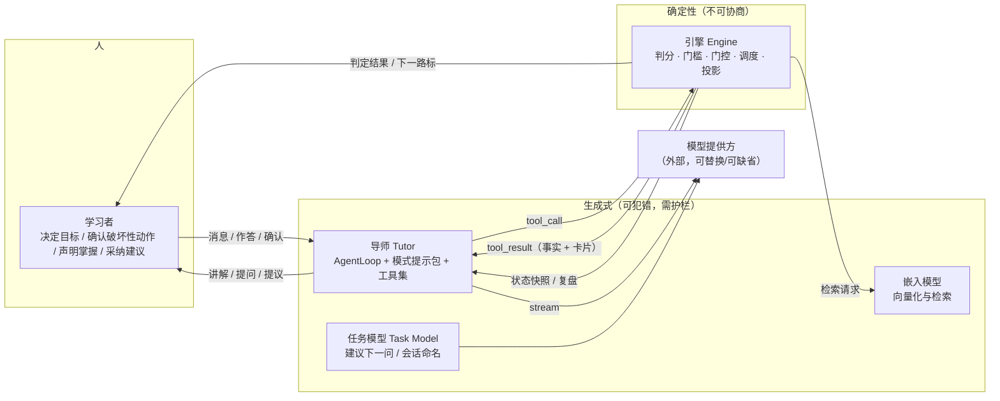
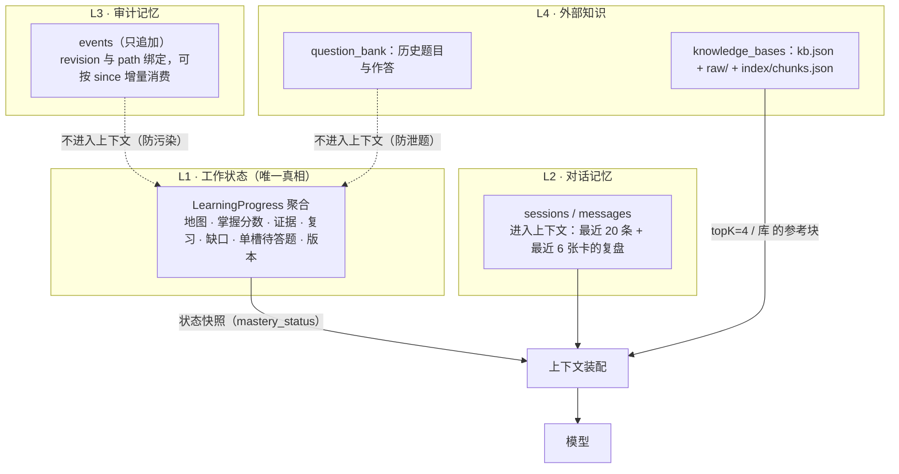
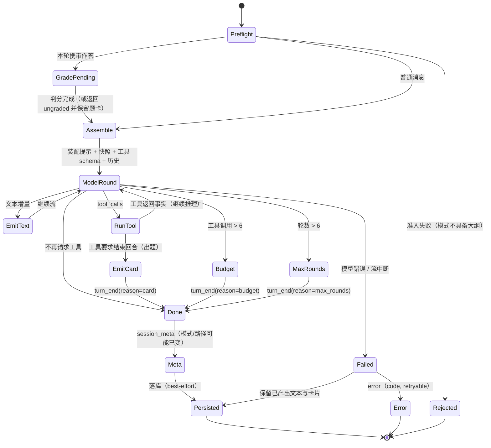
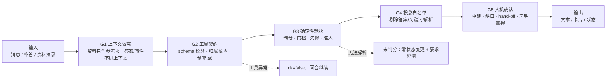

# 03 · 智能体系统专项设计

> 对应作业要求中"智能体系统的特殊关注点"：**智能体角色、工具接口、记忆与状态、编排、护栏**。
> 本系统的智能体不是"一个会说话的模型"，而是"模型 + 一套被门控的工具 + 一个只读状态快照 + 一组确定性裁决"的组合体。这一节把这四件事拆开设计。

## 1. 角色与职责边界



| 角色 | 是什么 | 能做什么 | 明确不能做什么 |
| --- | --- | --- | --- |
| **导师（Tutor）** | 通用 Agent Loop + mastery 提示包 + 挂载工具 | 讲解、出题、追问、定性评估、提议候选目标、切换模式、生成导航卡片 | 不能判定掌握、不能推进路标、不能重建大纲、不能删除数据、不能直接改库 |
| **引擎（Engine）** | `domain` 纯函数 + `service` 事务 | 判分、门槛裁决、算下一路标、排复习、投影、校验入参 | 不生成自然语言、不调用模型、不猜 |
| **任务模型（Task Model）** | 小模型 + 确定性回退 | 生成"下一问"草稿、会话命名 | 失败必须回退文案，绝不阻塞用户 |
| **嵌入模型** | HTTP 嵌入服务 | 文档分块向量化、查询向量化 | 不参与判分、不参与教学 |
| **学习者** | 人 | 目标设定、破坏性动作确认、声明掌握、缺口决策、hand-off 落地 | —— |

**一个刻意的非对称**：导师拥有"提议权"，引擎拥有"裁决权"。这不是把模型当接口层，而是承认它擅长生成、不擅长判定——SRS 里的"避免被模型幻觉击穿"在架构上就是这一条。

## 2. 自主性分级

| 动作 | 自主级别 | 机制 |
| --- | --- | --- |
| 讲解、追问、举例 | **A（自主执行）** | 无副作用，仅文本流 |
| 出题 / 登记答案 | **A（受预算约束）** | 单回合工具 ≤6；连续追问 ≤3；同题提示 ≤2；出题即结束回合 |
| 定性评估（concept/design） | **A（受类型约束）** | 只能作用于 `concept`/`design`；只写 `qualitativeMastery`，不写 `masteryLevels` |
| 切换模式 | **B（自主 + 必须告知）** | 工具 `mastery_mode` 校验准入并持久化，`session_meta` 事件回写前端 |
| 提议候选目标 / 记录缺口 | **B（只记录，不生效）** | 写入 `proposals` / `source_gaps`，需在大纲模式 reconcile 才成为 KP |
| 推进路标 / 宣告掌握 | **C（无权）** | 由 `MasteryPolicy` 计算，模型只能读 `nextObjective` |
| 重建大纲 | **D（必须人确认）** | 非空路径重建需 `confirm=true`，否则拒绝并列出将丢失内容 |
| 删除路径 / 会话 | **D（只能人操作）** | 仅 REST，模型无此工具 |
| 缺口接受 / 补充来源 | **D（人的决定）** | 缺口必须显式处理，禁止静默重建或静默丢弃 |
| 从前端跳转到学习页 | **D（只能给卡片）** | 导航工具返回 `mastery_handoff` 卡片，跳转由学习者点击 |

这张表是"设计决策"而非描述：自主级别越高的动作，越靠近**不可逆性低、可被投影检查**的一端；凡是会改变"进度的真相"的动作，一律降到 C/D。

## 3. 工具接口

### 3.1 契约

每个工具是三段式：**名字 + JSON Schema 入参 + `ToolResult` 出参**。

```text
ToolResult { ok: bool, content: string, metadata: map }   // metadata 承载卡片与判分结果
```

四条不变量（都可由测试断言）：

1. **失败不毒化**：未知工具、参数不可解析、工具内部异常，都返回 `ok=false` 并把原因写进 `content`，回合继续（`AgentLoop` 不因单次工具失败退出）。
2. **事实优先**：工具返回的是"引擎算出来的事实"（如 `next_objective`、判分结论），不是模型的自我判断；模型要基于事实说话。
3. **卡片即副作用边界**：`mastery_quiz` 的返回携带 `metadata.question_card`，`TurnRunner` 据此派生 `question_card` 事件；卡片是否含答案由**投影层**决定，工具不自行拼装敏感字段。
4. **schema 与归类同源**：工具的 schema 在 `ToolSchemas`，模式归属在 `ToolClassification`；两张表必须覆盖同一集合，否则启动期 `assertClassificationComplete` 失败。

### 3.2 工具清单（23 个）

| 组 | 工具 | 可用模式 | 作用 |
| --- | --- | --- | --- |
| 大纲 | `mastery_build` / `mastery_revise` | outline | 整图生成 / 差分修订（保留进度） |
| 学习 | `mastery_quiz` / `mastery_grade` / `mastery_skip_question` / `mastery_note_explained` / `mastery_defer_objective` | study、review | 出题、判分、跳过、记录讲解、暂缓目标 |
| 评估与修复 | `mastery_assess` / `mastery_repair_question` | study、review | 定性评估；作废/改正坏题并重算证据 |
| 提议 | `mastery_propose_objective` / `mastery_note_gap` | study、review | 记录候选目标与缺口（不改地图） |
| 状态与导航 | `mastery_status` / `mastery_mode` / `mastery_paths` / `mastery_switch` / `mastery_leave` / `mastery_topics` / `mastery_sessions` / `mastery_open_session` / `mastery_new_session` | 共享 | 读快照、切模式、切/离路径、浏览主题与会话、生成交接卡 |
| 画像 | `mastery_profile` | 共享 | 合并学习者画像字段 |
| 来源 | `rag` / `read_source` | 共享（条件挂载） | 检索知识库片段 / 读来源全文（≤20000 字符） |

关键设计点：

- **共享 ≠ 无门控**：`shared` 表示"三个模式都允许"，仍走 `ModeGate.toolIsAllowed` 调用期校验；只有未归类工具会被"放行"，而它们在注册期就已经不可能存在。
- **条件挂载**：`rag` 仅在路径绑定知识库时挂载，`read_source` 仅在存在来源索引时挂载。这样模型看不到"调了也没用"的工具，减少无效调用与上下文噪声。
- **归属顺序即提示顺序**：模式归属按 `SessionMode` 声明顺序（outline → study → review），拒绝时建议"第一个可用模式"，避免"请切到复习模式"这种错误引导。

### 3.3 工具层的三个"防呆"

| 防呆 | 触发 | 行为 |
| --- | --- | --- |
| 重复出题 | 已存在未答题 | 重放同一张卡，不新建（单槽位） |
| 连续追问 | 连续出题 ≥3 次未作答 | 拒绝注册，要求先作答 |
| 出题越权 | 复习模式考未掌握点 | 拒绝，并提示切到学习模式 |

## 4. 记忆与状态



**为什么分四层而不是"一个大的聊天历史"：**

1. **L1 是结构化的真相，模型只能读快照。** 快照包含：目标、当前模式、下一路标（含动作建议）、待答题、到期复习、整张地图摘要。把"下一步该做什么"提前算好，模型就不需要（也不被允许）自己推断进度。
2. **L2 是会话记忆，长度硬上限。** 最近 20 条消息 + 6 张卡的复盘（"你刚考过什么、结果如何"）。上限的意义是**可预测的成本**：单回合 token 不会随对话长度线性增长。
3. **L3 是审计，不是记忆。** 事件流刻意不进入模型上下文——它包含答案键、判分结论、内部错误，进上下文既浪费又泄题。
4. **L4 是知识与题库，按需检索。** 知识库只在路径绑定了库时以"参考块"形式注入；题库只在刷题与题库页出现，从不进入导师上下文。

**状态写入的唯一路径**：`service` → `LearningStore.mutate(pathId, fn)` → 读版本 → 就地修改 → `WHERE version=?` 写回 → 同事务写事件。任何组件（包括工具）都不能绕过。这条约束把"智能体的副作用"收敛成一个可重试、可审计、可并发安全的操作。

## 5. 编排

### 5.1 回合状态机



**四个结束原因是设计出来的，不是兜底**：`done`（正常）、`card`（出题即收口）、`budget`（成本护栏）、`max_rounds`（死循环护栏）。四者都会先发 `turn_end` 再发 `session_meta`，顺序不可调换（前端依赖"回合结束后才知道模式/路径有没有变"）。

### 5.2 回合前的装配顺序

```
系统提示（8 块，顺序固定）
  mastery_tutor → mastery_session_mode → runtime_context → runtime_policy
  → mastery_loop（回合协议）→ mastery_playbook → tool_call_policy → tools（挂载后的工具清单）
+ extra_context：状态快照头 + mastery_status 输出 + 会话复盘头 + 最近 6 张卡 + 知识库参考块
+ 历史消息（≤20）+ 本轮用户消息（模板包裹）
```

顺序被当作协议：模式包必须在回合协议之前（否则模型先学"怎么循环"再学"这个模式能干什么"），工具清单必须最后（它随挂载结果变化，放在末尾便于校验一致性）。

### 5.3 能力分派

| `capability` | 走向 | 事件序列 |
| --- | --- | --- |
| `mastery_path`（默认） | `TurnRunner` + `AgentLoop` | `text_delta* / tool_call / tool_result / question_card / turn_end / session_meta` |
| `deep_question` | `QuizSetTurn`（结构化生成题卷） | `quiz_plan → quiz_question×N → quiz_set → turn_end(reason=quiz_set)`；失败 `error + turn_end(error)` |
| `chat`（SSE 通道） | `ChatService` + 同一 `AgentLoop`（只挂 4 个只读导航工具） | `text_delta / tool_call / tool_result / turn_end` |
| 未知能力 | 直接 `error` | **必须**报错，不得静默回退成聊天 |

最后一条是设计红线：`capability` 是"意图"，静默降级会让用户以为在做练习，实际在聊天。

## 6. 护栏（Guardrails）



| 层 | 防的是什么 | 具体机制 | 可验证性 |
| --- | --- | --- | --- |
| G1 | 提示注入与泄题 | 外部资料以"参考材料"块注入，权限不随资料变化（权限在服务端）；事件流与题库不进上下文 | 上下文装配可断言 |
| G2 | 越权与成本 | 静态模式分类表（fail-closed）、schema 校验、单回合 ≤6 次工具、连续追问 ≤3 | 启动守卫 + 回合用例 |
| G3 | 幻觉裁决 | 判分/门槛/调度为纯函数；`open` 题判对也只记 `partial`；定性类型不看选择题 | 逐值单测 |
| G4 | 泄题 | 三个 Projector 白名单：掌握题卡 7 个公开键、题卷提交前无答案、题库刷题卡无答案与解析 | 契约用例 |
| G5 | 不可逆动作 | 重建需 `confirm`；缺口需显式处理；hand-off 只给卡片；声明掌握单独记录来源 | REST/WS 用例 |
| G6 | 失败扩散 | `ungraded` 零状态变更；模型错误保留已产出文本 + `error(retryable)`；任务模型四重回退 | 故障注入用例 |

**一条容易被忽略的护栏：重复提交幂等。** 同一题重复作答返回首次结果、不重复记账；题卷重复提交返回首次结果。没有这条，"网络重试"就会变成"刷分"。

## 7. 记忆与编排的失败模式（设计时已考虑）

| 失败模式 | 现象 | 设计应对 | 仍未解决 |
| --- | --- | --- | --- |
| 模型反复调用同一工具 | 回合内 6 次调用耗在 `mastery_status` | 预算硬上限 + 结束原因可见 | 没有调用去重/缓存（OQ-04） |
| 模型"忘记"模式 | 在 outline 模式尝试出题 | 调用期拒绝 + 建议正确模式 | 拒绝会消耗一次工具预算 |
| 上下文过长 | 长会话后回答漂移 | 历史 20 条 + 6 张卡复盘 + 结构化快照 | 没有摘要压缩（OQ-07） |
| 模型编造知识点 id | 工具参数指向不存在 KP | 引擎校验并返回可操作错误 | 模型需自行纠正，无自动重试 |
| 生成题卷结构不合法 | 少题、缺答案 | 结构校验 + 一次"修复重试" + 题数必须恰好相等 | 两次都失败则整卷失败（不落半卷） |
| 流中断 | 半句话丢失 | 先落已产出内容，再发 `error` | `error` 路径不发 `turn_end`，前端需按 `error` 收口（OQ-08） |

## 8. 如何验证智能体行为（为验证而设计）

1. **脚本化假模型**（`FakeLlmClient`）：按顺序返回预置响应，并记录"模型实际看到的工具 schema"，因此可以断言"某模式下 `mastery_build` 是否真的被下发"。
2. **离线确定性回放**：判分、门槛、调度、门控全部不依赖模型，可对同一输入重复断言。
3. **生成质量离线评测**：大纲评测 CLI 输出 `kp_precision / kp_recall / kp_f1 / count_in_bounds / acyclic`，可对基线做回归（F1 退化 > 0.05 即失败）。
4. **事件级可观测**：每次工具调用都有 `tool_call` / `tool_result` 事件，配合 `[mock-llm]` 日志可复现"模型到底做了什么"。
5. **第三部分 PoC 要检验的假设**（详见 [08](08-risks-open-questions.md)）：提示包能否稳定驱动正确的工具序列；预算 6 是否够用；定性评估与人工评分的一致率；题卷生成的可用率。
