# 05 · 设计模型

> 对应作业工件 3。系统级图（C4 上下文 / 容器 / 组件）在 [02](02-architecture.md)，智能体回合状态机在 [03](03-agentic-design.md)；
> 本节聚焦**领域结构**与**关键用例的交互**。所有图使用 UML 语义（Mermaid 语法），类名 / 表名与代码一致。

## 1. 领域类图（关键抽象、职责、重要属性）

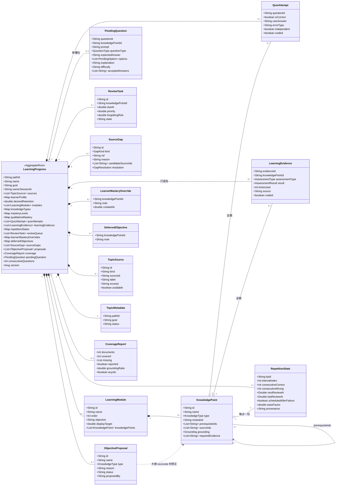

### 1.1 规则对象（无状态、纯函数，与实体分开画）

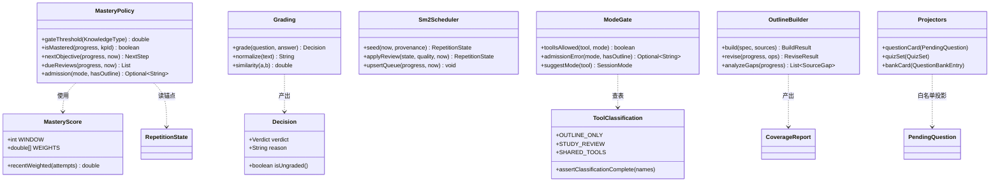

**为什么把"规则"单独画？** 因为它们是可被替换、可被单测、可被第三部分 PoC 标定的部分；实体是数据的形状，规则是产品的承诺。把两者混在一张图里，会让人误以为"改规则 = 改数据结构"。

> 图中方法名为**职责示意**（表达"这类规则负责什么"），精确签名以代码为准；常量值是契约（见 [04](04-adr.md) ADR-04/05/07 与 `domain` 源码）。

## 2. 存储模型（ER）

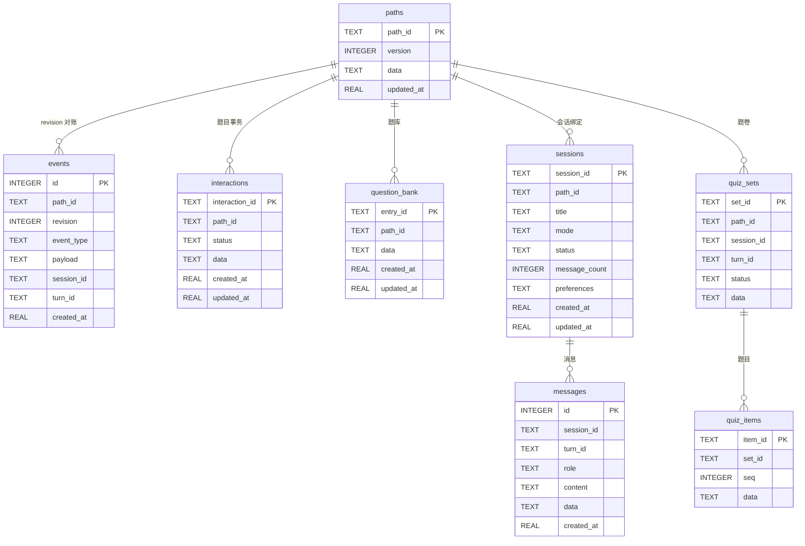

三点设计说明：

1. **`paths.data` 是唯一真相**（ADR-02），其余表都是"便于查询/审计的旁路"：`events` 只追加不重建，`question_bank` 是证据的可读副本，`interactions` 是幂等锚点。
2. **`sessions.mode` / `has_pending_question` 是冗余字段**，用于列表页与导航，不参与判定；判定永远读聚合。
3. **知识库不在库里**：`knowledge_bases/<id>/{kb.json, raw/, index/chunks.json}` 以文件系统为真相，理由是原始文档必须人类可读、可被用户直接复制（见 [02](02-architecture.md) §3）。

## 3. 交互模型（关键用例）

### 3.1 UC-02 生成大纲（含缺口处理）

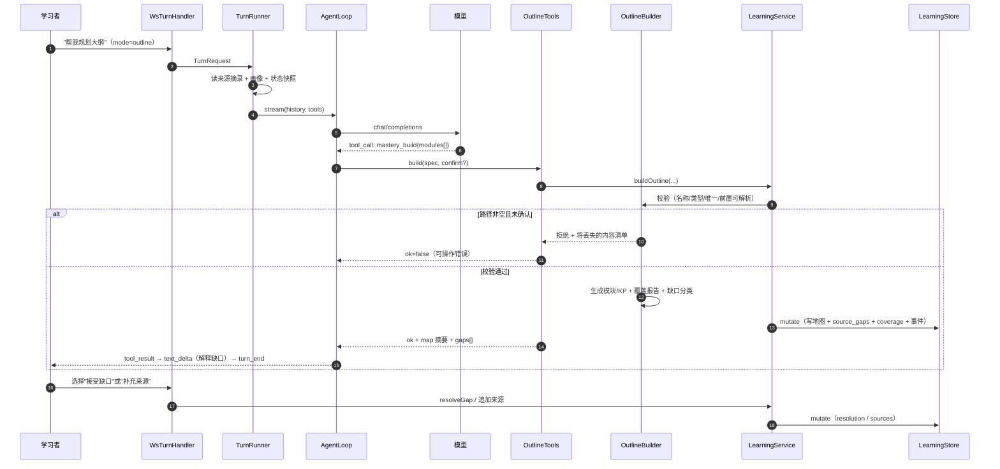

### 3.2 UC-08 定性评估（concept / design）

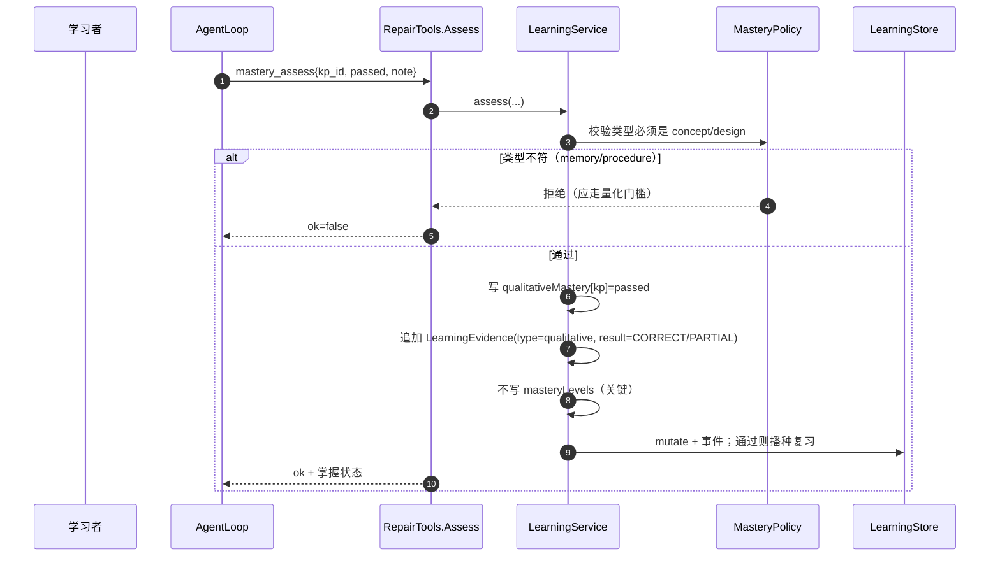

### 3.3 UC-10 复习到期

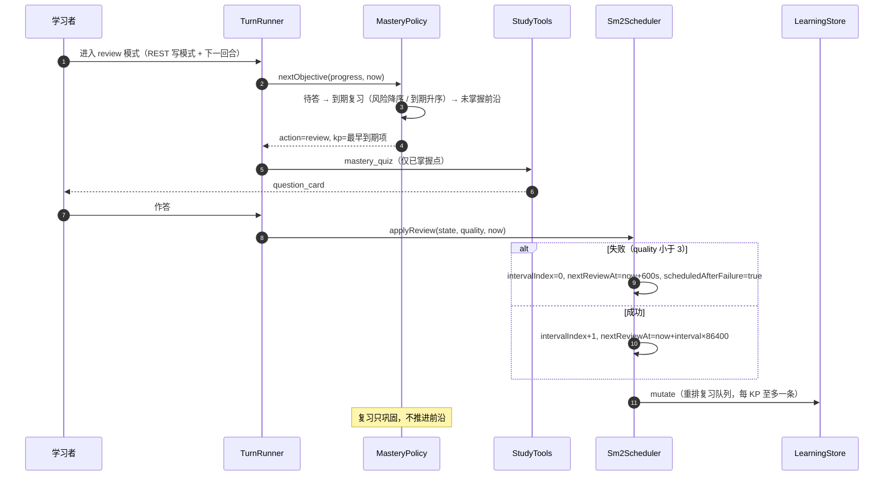

### 3.4 声明已掌握（双轨）

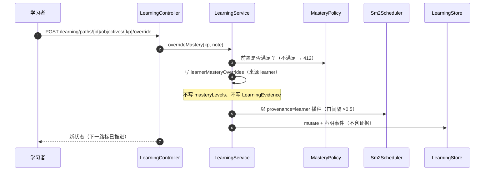

### 3.5 知识库装配与检索（回合侧）

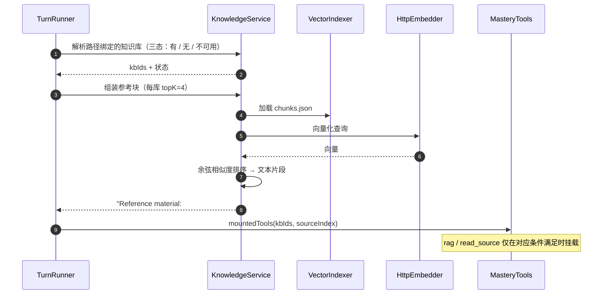

## 4. 状态模型

### 4.1 题目交互（`InteractionStatus`）

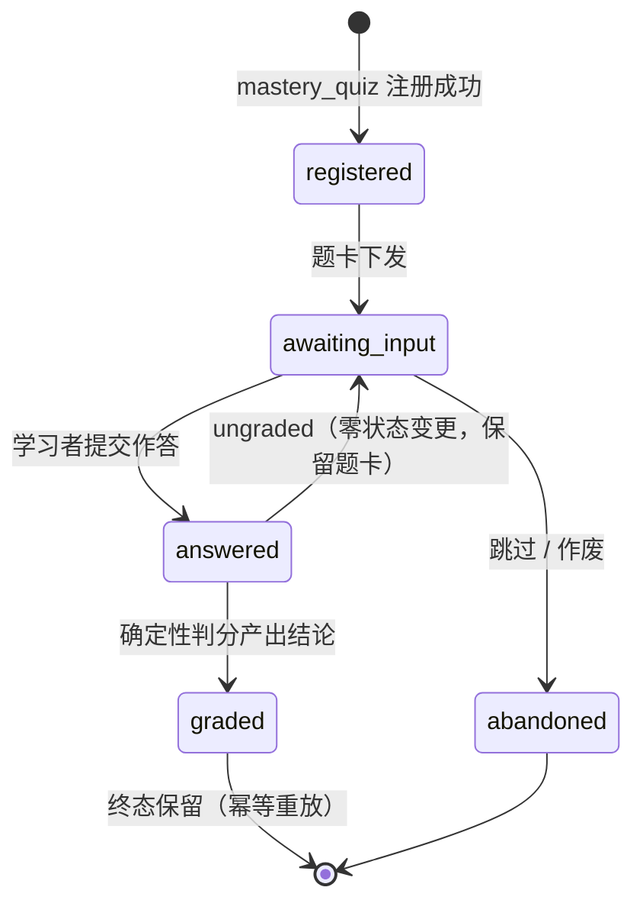

### 4.2 知识点掌握与复习（派生状态）

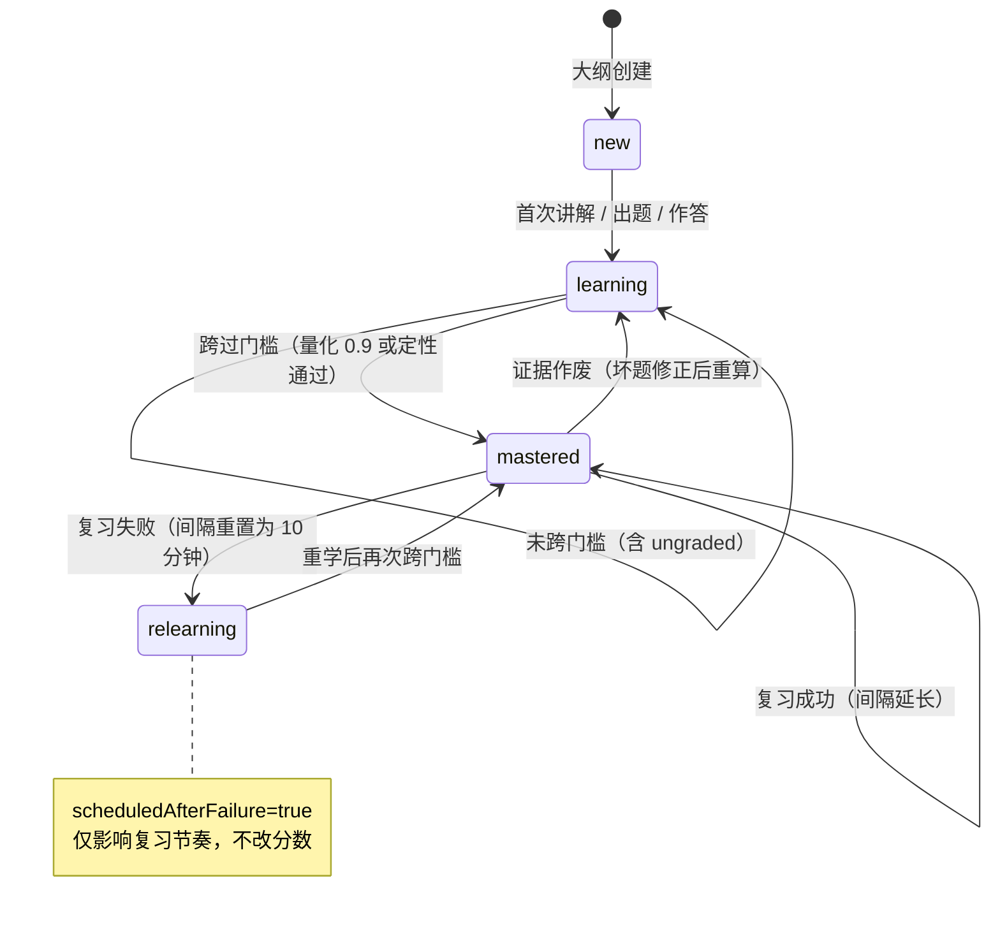

### 4.3 路径与会话（导航侧）

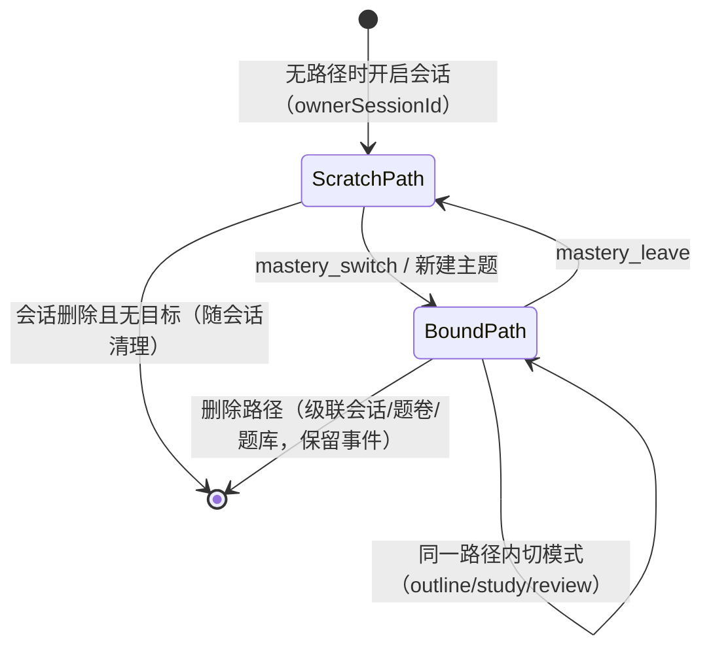

## 5. 活动模型：大纲生成 → 缺口消解

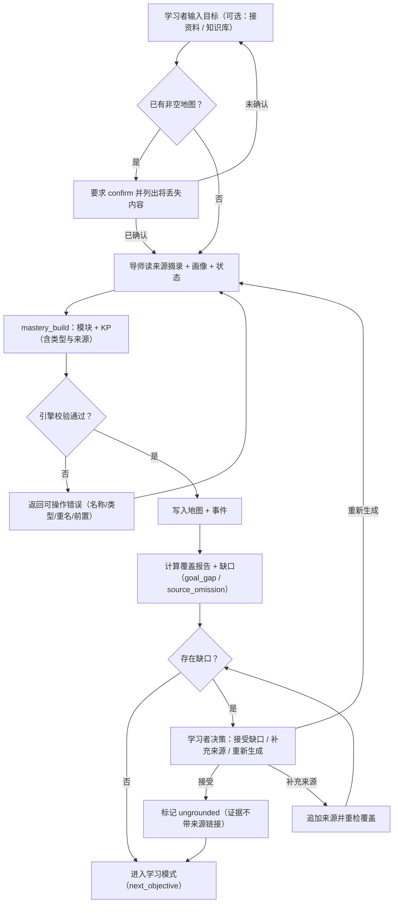

## 6. 用例 → 模型映射（便于逐条评审）

| 用例 | 主要参与组件 | 关键事件 / 端点 | 模型证据 |
| --- | --- | --- | --- |
| UC-02 生成大纲 | `TurnRunner`、`OutlineTools`、`OutlineBuilder`、`LearningService` | `tool_call: mastery_build` | §3.1、§5 |
| UC-03 编辑大纲 | `OutlineTools.Revise`、`LearningService` | `mastery_revise`（差分 ops，保留进度） | §1、ADR-02 |
| UC-05 缺口处理 | `LearningService`、`SourceGap` | `POST .../gaps/{id}/resolve` | §5 |
| UC-06 讲解与出题 | `AgentLoop`、`StudyTools.Quiz` | `question_card` + `turn_end(card)` | §4.1、[03](03-agentic-design.md) §5 |
| UC-07 作答判分 | `TurnRunner`（答前判分）、`Grading`、`MasteryScore` | `tool_result.mastery_grade` | §4.1、ADR-05 |
| UC-08 定性评估 | `RepairTools.Assess`、`MasteryPolicy` | `mastery_assess` | §3.2 |
| UC-09 声明掌握 | `LearningController`、`LearningService`、`Sm2Scheduler` | `POST .../override` | §3.4、ADR-08 |
| UC-10 复习到期 | `MasteryPolicy`、`Sm2Scheduler` | `GET .../review-queue` | §3.3、§4.2 |
| UC-12 配置提供方 | `SettingsController`、`ProviderProbe`、`SettingsStore` | `POST /settings/providers/probe` | [02](02-architecture.md) §3 |
| UC-13 切换模式 | `SessionController`、`SharedTools.Mode`、`ModeGate` | `PUT .../mode`、`session_meta` | §4.3、ADR-03 |
| UC-14/15 判定与排期 | `MasteryPolicy`、`Sm2Scheduler` | 内部纯函数 | §1.1、§4.2 |
| 生成型练习卷 | `QuizSetTurn`、`QuizSetGenerator`、`QuizSetService` | `quiz_plan / quiz_question / quiz_set` | ADR-15 |
