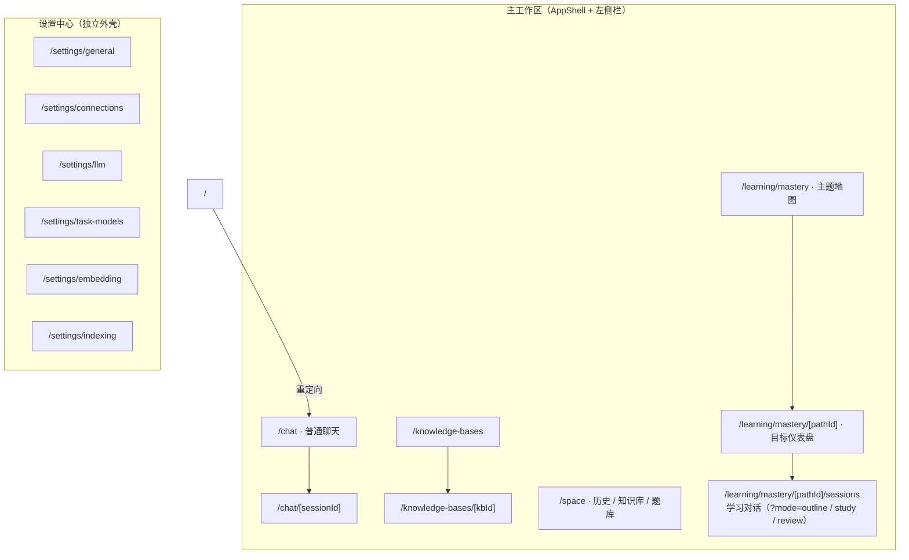
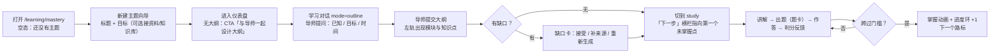
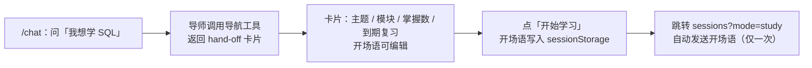

# 06 · UI 与 UX 设计

> 对应作业工件 5。原则：**界面只呈现"引擎已裁定的事实"，不用视觉暗示未经判定的进度**。
> 界面原型为低保真线框（ASCII），以真实组件名为准（`web/components/**`），因此线框与实现一一对应。

## 1. 信息架构



设计取舍：

- **掌握之路是二级结构，不是"一个页面"**：图集（我有哪些主题）→ 仪表盘（这个主题到哪了）→ 学习对话（现在做什么）。三层各自回答一个问题，避免"所有信息堆在一个屏"。
- **设置中心独立外壳**：它是低频、危险（含密钥）的区域，与学习动线物理隔开，左侧栏固定"返回主应用"。
- **`/space` 不承担学习入口**：它只做"回看"（历史对话、知识库、题库），学习动线始终从主题进入。

## 2. 关键用户流程

### 2.1 从零到第一个知识点（首次使用）



### 2.2 从聊天到学习（hand-off）



关键：**模型只能给卡片，不能替用户跳转**（导航是人的动作，见 [03](03-agentic-design.md) §2）。

### 2.3 复习动线

仪表盘右栏「复习计划」列出到期项（风险降序、到期升序）；点「复习」→ 进入 `mode=review` → 题卡只针对已掌握点 → 判分后 SM-2 重排 → 回到仪表盘看到新的到期日。

## 3. 界面清单（路由 × 目的 × 关键组件 × 状态）

| 路由 | 目的 | 关键组件 | 必须设计的非happy-path |
| --- | --- | --- | --- |
| `/learning/mastery` | 我有哪些主题、哪些到期 | `TopicAtlas`、`TopicMapCard`、`CreateTopicWizard` | 空态（无主题）、到期角标、加载骨架 |
| `/learning/mastery/[id]` | 这个主题到哪了 | `LearningShell`、`ProgressRing`、`ModuleOutline`、`ReviewTrail`、`LearnerProfileCard`、`SessionCamp` | 无大纲（CTA 建大纲）、目标未接地标记、无到期项 |
| `/learning/mastery/[id]/sessions` | 现在做什么 | `ModeSwitch`、`StudyOutline`、消息流、`QuestionCard`、`QuizViewer`、`MasteryHandoffCard`、`MessageComposer` | 准入被拒（学习但无大纲）、`ungraded`、流中断、题卷生成中 |
| `/chat`、`/chat/[id]` | 通用问答与导航 | `ChatWorkspace`、`ToolActivity`、`MessageComposer` | 首次发送自动建会话、撤回、工具失败折叠展示 |
| `/knowledge-bases`、`/kbd` | 资料入库与索引状态 | `KnowledgeBaseList`、`KnowledgeBaseDetail`、`CreateKnowledgeBaseModal` | `rag_prerequisite_missing`、索引进度、空库 |
| `/space` | 回看与刷题 | `SpaceWorkspace`、`QuestionBankPanel`、`PracticeRunner`、`TagManagerDialog` | 无题目、标签为空、刷题无可判题 |
| `/settings/*` | 配置模型与索引 | `SettingsShell`、`SettingsNav`、`ProvidersWorkspace`、`ModelsWorkspace`、`ProviderProbe`、`IndexingSettings` | 未添加提供方、探测失败、Key 掩码 |

## 4. 低保真线框

### 4.1 主题仪表盘（`/learning/mastery/[pathId]`）

```text
┌────────────────────────────────────────────────────────────────────────────┐
│ ← 掌握之路      数据库系统            ● 已完成 12 / 20      [大纲][学习][复习]│
│ 目标：能独立设计并解释一个订单库的表结构与索引策略        （原始目标始终可见）│
├────────────────────────────────────────────────────────────────────────────┤
│ 下一步 ▸ 3.2 联合索引与最左前缀    [继续学习]        （唯一主行动）           │
├───────────────────────────────────┬────────────────────────────────────────┤
│ 大纲                              │ 复习计划                                │
│ ▸ 模块 1 基础      ●●●○○  3/5     │ 今天到期 2 项                           │
│   ● 1.1 关系模型      memory  ✓   │  · 2.3 B+ 树  风险 0.72  [复习]          │
│   ◉ 1.2 键与约束      concept     │  · 1.4 事务隔离 风险 0.41 [复习]         │
│   ○ 1.3 范式（未接地） concept    │ 目标保留率 ────●──── 0.90               │
│ ▸ 模块 2 索引      ●●○○○  2/5     │                                        │
│                                   │ 学习者画像  · 目标：面试  · 每周 5h       │
│                                   │ 会话营地   · 大纲共创（昨天）  [打开]     │
└───────────────────────────────────┴────────────────────────────────────────┘
```

要点：**进度环与"下一步"只反映引擎结论**；"未接地"用文字标记而非仅在 tooltip 里；目标在 header 常驻（可用性目标之一）。

### 4.2 学习对话（`/learning/mastery/[pathId]/sessions`）

```text
┌──────────────┬─────────────────────────────────────────────────────────────┐
│ 大纲轨        │ 数据库系统 › 3.2 联合索引与最左前缀     ●●●●●○  [大纲|学习|复习]│
│ ✓ 1.1 关系模型├─────────────────────────────────────────────────────────────┤
│ ✓ 1.2 键与约束│ 导师：上一题你把 (a,b) 和 (b) 的区别讲清楚了……                │
│ ◉ 3.2 联合索引│                                                             │
│ ○ 3.3 覆盖索引│ ┌─────────────────────────────────────────────────────────┐ │
│ ○ 3.4 索引失效│ │ 选择题 · 中等                                            │ │
│              │ │ 下列哪条查询能用上 idx(a,b)？                            │ │
│ （可折叠为    │ │  (A) WHERE b = 1                                         │ │
│   竖排书脊）  │ │  (B) WHERE a = 1 AND b = 2      ← 点选即作答              │ │
│              │ │  (C) WHERE b = 2 AND a = 1                               │ │
│              │ └─────────────────────────────────────────────────────────┘ │
│              │ ┌─────────────────────────────────────────────────────────┐ │
│              │ │ 判分：正确 ✓  解析：最左前缀要求……                        │ │
│              │ └─────────────────────────────────────────────────────────┘ │
│              │                                                             │
│              │ ▸ 工具动作（3）  状态快照 · 出题 · 判分          ← 可折叠     │
├──────────────┴─────────────────────────────────────────────────────────────┤
│ [ 输入你的理解…… ]                       建议：解释 B+ 树为什么适合范围查询 │
│                                    按 Tab 采纳建议 ↑          [发送]        │
└────────────────────────────────────────────────────────────────────────────┘
```

要点：

- **题卡是消息流里的独立卡片**，不是弹窗——它属于这段对话，可回看、可复盘。
- **判分气泡与题卡分离**：判分结论来自 `tool_result.metadata.mastery_grade`，因此视觉上不与模型的话混在一起。
- **工具动作默认折叠**（`ToolActivity`）：让学习者看到"导师做了什么"，但不被 JSON 干扰。
- **Tab 采纳建议**：建议来自服务端（失败则无建议），采纳后仍需用户主动发送——建议不是自动发言。

### 4.3 生成型练习卷（同页，`deep_question`）

```text
┌──────────────────────────────────────────────────────────────┐
│ 练习卷 · 5 题 · 中等                    （生成中 3/5 …）      │
│ ─────────────────────────────────────────────────────────── │
│ 1/5  单选  下列哪个是聚簇索引的特征？        (A)(B)(C)(D)     │
│ 2/5  填空  索引选择性 = ______ / ______                      │
│ …                                                            │
│                                        [提交整卷]             │
└──────────────────────────────────────────────────────────────┘
提交后：逐题显示正误 + 解析；页脚提示「练习卷不计入掌握分数」
```

**这条文案是必须的**：题卷独立于掌握证据（ADR-15），界面必须明说，否则用户会误以为"做了卷没涨分 = 系统坏了"。

### 4.4 设置中心 · 提供方（`/settings/connections`）

```text
┌───────────────┬────────────────────────────────────────────────────────┐
│ ← 返回主应用   │ 提供方            [添加提供方]                          │
│ 通用           ├───────────────────────┬────────────────────────────────┤
│ 连接 ✓         │ DeepSeek            ● │ 名称  DeepSeek                 │
│ 语言模型       │ 本地 Ollama        ○ │ 地址  https://api.deepseek.com │
│ 任务模型       │ 自定义             + │ 密钥  ••••••••••  [测试连接]    │
│ 嵌入模型       │                       │ 协议  [openai ▾]   已连接 ✓     │
│ 索引           │                       │                                │
└───────────────┴───────────────────────┴────────────────────────────────┘
```

要点：主从布局（左列表右编辑器）；密钥输入为密码框，"测试连接"不需要重输密钥（后端回退已保存值）；探测只拉模型列表，不做计费推理。

## 5. 视觉与交互规范（"掌握状态语言"）

| 维度 | 规范 | 理由 |
| --- | --- | --- |
| 语义色令牌 | `background / foreground / card / muted / primary / secondary / accent / border / ring / destructive`，全部映射 CSS 变量（主色 `#2563eb`，危险 `#dc2626`） | 组件不写死颜色，换主题只改变量 |
| **状态不只用颜色** | 掌握状态用"填充 → 环 → 细描边 → 虚线"四种形态（`.mastery-dot-mastered/current/learning/new`） | 色盲友好；黑白打印也可辨 |
| 字体 | `system-ui, -apple-system, "Segoe UI", "PingFang SC", "Microsoft YaHei"` | 中英混排与跨平台一致 |
| 圆角 | `--radius: 0.75rem`，卡片 `rounded-xl/2xl` | 与"卡片即单位"的信息结构一致 |
| 动效 | 掌握浮层 2.2s 自动消失；`prefers-reduced-motion` 下禁用 | 庆祝是反馈，不是干扰 |
| 键盘 | `Tab` 采纳建议（输入框为空时）；`Enter` 发送，`Shift+Enter` 换行 | 高频动作零鼠标 |
| 响应式 | `AppShell` 左侧栏在窄屏折叠为抽屉 | 移动端先能读，再谈编辑 |
| 语言 | 中 / 英双语，305 个扁平键（`app.* / dash.* / study.* / q.* / settings.*` 等），默认中文，存 `localStorage` | 键即契约，缺键可被静态发现 |
| 暗色 | `.dark` 令牌已定义，**未启用** | 见 OQ-09：本期不做切换入口 |

## 6. 状态与文案设计（错误也是 UX）

| 场景 | 界面表现 | 文案原则 |
| --- | --- | --- |
| 学习模式但无大纲 | 输入区禁用 + CTA「先设计大纲」 | 说明"为什么不能开始"，而不是只报错 |
| 模式越权（模型或用户触发） | 顶部提示 + 自动建议正确模式 | 给出下一步动作，不指责用户 |
| 作答无法解析（`ungraded`） | 题卡保留 + 提示"我没看懂你的答案，能换个说法吗" | **不显示对/错**，不扣分 |
| 模型流中断 | 已生成文本保留 + 可重试条（`retryable`） | 保留现场，不丢已读内容 |
| 题卷生成失败 | 整卷失败提示 + 重试 | 不展示半卷 |
| 知识库缺嵌入模型 | 状态标签 `需先配置嵌入模型` + 跳设置 | 状态即行动指引 |
| 缺口未处理 | 缺口卡常驻仪表盘 | 缺口必须显式处理，不允许"看不见" |
| 声明掌握 vs 系统掌握 | 大纲上分别用"声明"徽标 / 实心圆点 | 两种来源视觉可区分（双轨模型） |

## 7. 可用性目标 → 界面承诺

| SRS 可用性目标 | 界面如何兑现 |
| --- | --- |
| 首次可编辑大纲 ≤ 3 分钟 | 图集页一键新建 → 直接落在 outline 模式会话，导师主动问 3 个问题；无需填表 |
| 单知识点闭环 ≤ 10 分钟 | "下一步"横栏一键继续；出题即结束回合，输入框立刻可用；Tab 采纳建议降低输入成本 |
| 任意时刻可见原始目标 | 仪表盘与学习页 header 常驻 `goal`（不折叠、不截断到 tooltip） |
| 模式按钮始终可见 | `ModeSwitch` 固定在会话页 header 右侧，当前模式高亮且不可点 |
| 复习队列精度（非到期项 < 10%） | 复习计划只列 `dueAt ≤ now` 的项；未到期项不进入队列（到期是提醒而非许可） |

## 8. 已知的 UI 缺口（进入第三部分或后续迭代）

1. **暗色主题**：令牌齐备但无切换入口与 `darkMode` 配置。
2. **`/settings` 无根页**：只能通过 `/settings/general` 等进入；从侧栏进入需落到默认分区。
3. **WS 附件通道未接**：`TurnRequest` 有 `attachments`，但 WS 解析未赋值；附件仅在普通聊天 SSE 中可用。
4. **移动端编辑**：大纲的增删改在窄屏上仍以查看为主。
5. **题卷与掌握的关系**：目前只靠页脚文案说明，未提供"把错题转为复习目标"的入口（见 OQ-10）。
