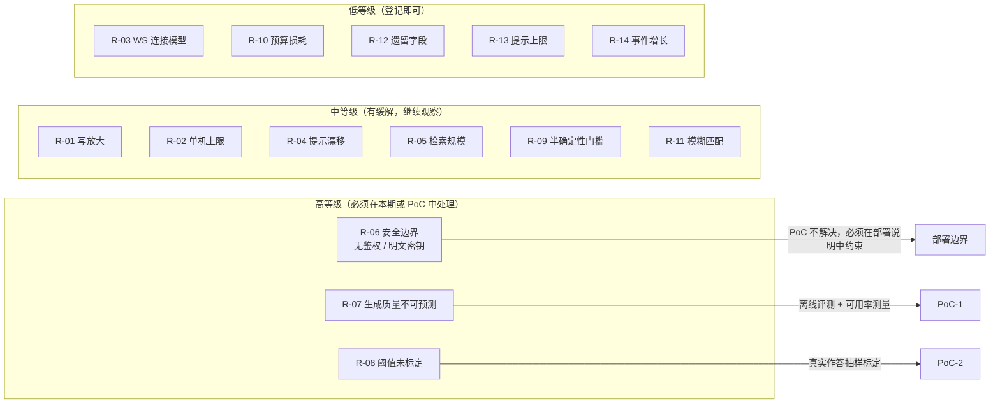
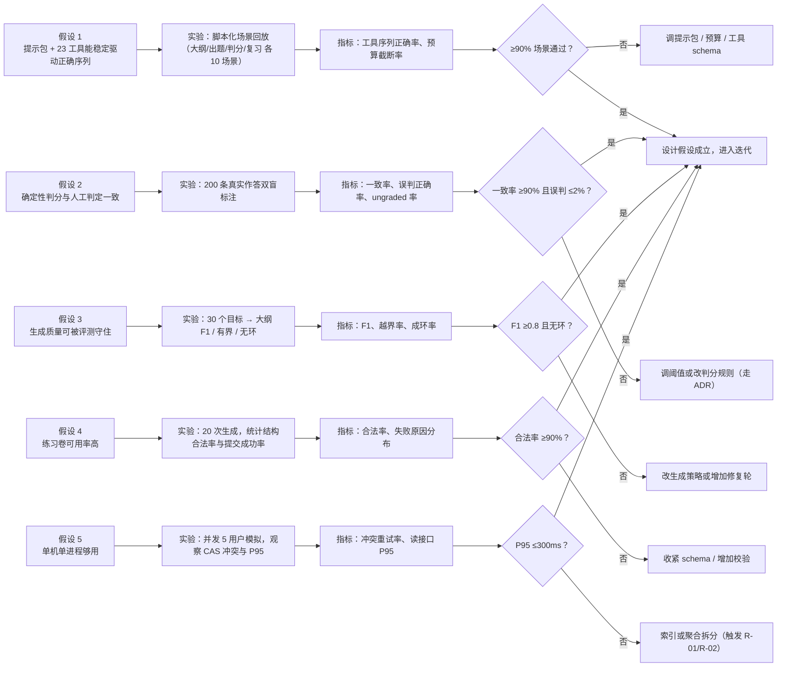

# 08 · 未决问题与风险

> 对应作业工件 6。两部分：**风险登记册**（已知会发生、需要持续缓解）与**未决问题**（设计阶段无法定论、必须由第三部分 PoC 或后续迭代裁决）。
> 每条都写"触发信号"——没有触发信号的风险等于没有登记。

## 1. 风险登记册

等级 = 概率 × 影响（高 / 中 / 低），并标注"现在是否有缓解措施落地"。

| # | 风险 | 概率 | 影响 | 等级 | 已有缓解 | 触发信号 |
| --- | --- | --- | --- | --- | --- | --- |
| R-01 | 聚合以 JSON 单行存储，路径变大后写放大 | 中 | 中 | 中 | KP 数上限（评测口径 1–60）、只写单路径、CAS 重试有界 | 单次 `mutate` 耗时随 KP 数明显上升 |
| R-02 | SQLite 单写 + 单进程，无法水平扩展 | 高 | 中 | 中 | 明确单用户边界；`storage` 层已隔离，可替换 | 出现"两人同时用同一实例/多设备同步"的需求 |
| R-03 | WS 每连接只处理一条请求，无断线续传 | 高 | 低 | 低 | 前端每次新建连接；回合粒度为原子 | 弱网下频繁重连、长回合中断率高 |
| R-04 | 系统提示里的工具清单只覆盖 `rag` / `read_source`（仅这两个工具有 hint 资产） | 高 | 中 | 中 | 22 个工具的 schema description 仍可用 | 模型频繁误用工具（如该出题却查状态） |
| R-05 | 向量检索为内存暴力点积 | 中 | 中 | 中 | 只加载选中库、分块上限、检索失败返回空而不阻塞 | 大规模库（数千文档）下检索延迟上升 |
| R-06 | 无鉴权 + CORS 全开 + `settings.json` 明文密钥 | 中 | 高 | **高** | 默认仅监听本机；Key 只进请求头、不回显响应、不写日志 | 需要局域网/远程访问；或设备被他人使用 |
| R-07 | 生成质量不可预测（大纲结构、题目可用性） | 高 | 中 | **高** | 结构硬校验 + 一次修复重试 + 覆盖报告 + 缺口显性化 + 离线评测 | 评测 F1 下降、题卷失败率上升、用户频繁重建 |
| R-08 | 阈值是未标定先验（0.9 / 0.90 / 0.60 / EF 2.5 / 保留率 0.9） | 高 | 中 | **高** | 常量集中在 `domain`，改一个地方即可 | 用户"明明会了却过不了"或"错很多却过了" |
| R-09 | 定性评估依赖模型，是唯一的"半确定性门槛" | 中 | 中 | 中 | 只作用于 concept/design，不写分数；证据单独标注类型 | 同一份解释两次评估结论不同 |
| R-10 | 越权拒绝也消耗一次工具预算 | 中 | 低 | 低 | 建议正确模式，模型通常一次纠正 | 回合在 `budget` 结束且原因是越权 |
| R-11 | 短答/开放题的模糊匹配会误判（同义表达、错别字） | 高 | 中 | 中 | "宁严勿宽"阈值；`ungraded` 兜底；错题可作废/改答案 | 用户投诉"我答对了被算错" |
| R-12 | 遗留的 FSRS 字段（`difficulty/stability/retrievability`）留而不用 | 高 | 低 | 低 | 仅展示层不使用；不参与任何判定 | 代码评审时被误读为"已支持 FSRS" |
| R-13 | "同题提示 ≤2" 只有常量与测试，主流程未消费 | 高 | 低 | 低 | 常量已定义，接入点明确 | 同一题被反复提示却无拦截 |
| R-14 | 事件表只增不减 | 高 | 低 | 低 | 删除路径不删事件（审计需要） | 长期使用后 `learning.db` 体积异常增长 |
| R-15 | `CasConflictException`（重试耗尽）未映射为 409 | 中 | 低 | 低 | 单用户下几乎不触发；日志保留原因 | 出现 5xx 且前端无法区分"并发冲突"与"服务故障" |

### 1.1 风险的"架构级"读法

**三条高风险的处理立场：**

- **R-06 不是"技术债"，是产品边界。** 本期的答案是"只在本机跑"。任何"共享给同学用"的诉求都必须先做鉴权，不能靠"内网所以安全"。
- **R-07 必须可测量。** 生成质量无法被"评审通过"保证，只能被离线评测与线上失败率保证；因此评测 CLI 被列为需求（RR-10），而不是工具。
- **R-08 的阈值必须能被解释给学习者。** 0.9 不是"科学常数"，是产品承诺；PoC 要做的是证明"它不会让正常人卡住"，而不是"它最优"。

## 2. 未决问题（Open Questions）

| # | 问题 | 现状 | 备选方案 | 验证方式 / 判据 |
| --- | --- | --- | --- | --- |
| OQ-01 | RAG（知识库检索）对学习效果是否真有增益？ | 已实现检索与参考块注入，但无效果对照 | A：保留并强化（引用到 KP） B：仅用于缺口检测 C：关闭 | 同一目标做 A/B 大纲与作答质量对比；判据：A 组"有来源支撑的 KP 占比"提升 ≥20% |
| OQ-02 | 单回合工具 ≤6、轮数 ≤6 是否够用？ | 常数已落地 | A：维持 6 B：提到 8–10 C：按模式分档 | 统计 `turn_end.reason=budget` 的比例与"被截断但没做完"的会话；判据：截断率 <5% |
| OQ-03 | WS 是否改成长连接 + 请求 id（支持断线续传/并发）？ | 每连接一条请求 | A：维持现状 B：长连接 + 多路复用 | 弱网注入实验；判据：中断回合的完成率提升是否值得引入会话状态管理 |
| OQ-04 | 工具调用是否需要去重/缓存（模型反复查状态）？ | 无 | A：不做（靠预算） B：同回合内幂等读缓存 | 统计同回合重复调用率；判据：>10% 再做 |
| OQ-05 | 是否为 22 个工具补齐 hint 资产（提示词内的工具说明）？ | 只有 `rag` / `read_source` 有 | A：全部补齐 B：只补高频 8 个 C：依赖 schema | 用假模型断言"工具选择准确率"；判据：补齐后误用率下降 ≥30% |
| OQ-06 | `settings.json` 明文 Key 是否改为系统钥匙串/加密？ | 明文（本地优先取舍） | A：维持 + 文档警示 B：系统钥匙串 C：本地主密钥加密 | 安全评审；判据：若产品允许"非本人使用设备"则必须做 B/C |
| OQ-07 | 长会话是否需要摘要压缩（当前 20 条 + 6 张卡）？ | 硬上限截断 | A：硬截断 B：阶段性摘要 C：按 token 预算动态裁剪 | 长会话（>40 回合）回答相关性评测；判据：相关性下降 >15% 则做 B |
| OQ-08 | 错误回合不发 `turn_end` 是否应统一？ | 掌握回合：`error` 收口；题卷：`error + turn_end` | A：统一为"必有 `turn_end`" B：维持现状 | 前端收口逻辑的复杂度评估；判据：是否出现"卡在生成中"的 UI 状态 |
| OQ-09 | 暗色主题是否启用？ | 令牌已定义，无开关 | A：本期不做 B：跟随系统 C：手动切换 | 用户访谈 + 实现成本；判据：≥30% 目标用户要求再做 |
| OQ-10 | 练习卷错题能否一键转为复习目标/候选 KP？ | 无入口 | A：不做 B：错题 → 候选目标提案 C：错题 → 直接插入复习队列 | 与"练习题不写证据"的边界是否冲突；判据：B 可行（走 `proposals` 而非直接写复习） |
| OQ-11 | 判定阈值如何标定？ | 全部为默认先验 | A：保持 B：用真实作答分布调 C：按类型分档 | 收集 ≥200 条真实作答，比较"人工判定 vs 引擎判定"一致率；判据：一致率 ≥90% 且误判正确率 ≤2% |
| OQ-12 | 是否支持多用户/多设备？ | 明确不支持 | A：维持单用户 B：加鉴权 + 服务端数据库 | 若做，`storage` 层需重写并引入回合协调（Redis 类）；成本远高于本期 |

## 3. 第三部分（PoC）验证计划

### 3.1 每个实验的最小可行做法

| 实验 | 怎么跑 | 需要什么数据 | 失败时的第一动作 |
| --- | --- | --- | --- |
| E1 工具序列 | 用假模型脚本 + 真引擎，断言工具调用序列与事件顺序；再换真模型跑同样场景 | 10 个覆盖三模式的脚本 | 先查提示块顺序与工具 schema，再查预算 |
| E2 判分一致 | 两人独立标注同一批作答（对/错/无法判定），与引擎结果比对 | ≥200 条真实或半真实作答 | 先看 `ungraded` 分布，再调相似度阈值 |
| E3 大纲质量 | 选 30 个不同领域目标，跑评测 CLI | 目标清单 + 来源文档 | 先看覆盖报告与缺口分类，再改生成提示 |
| E4 题卷可用 | 20 次 `deep_question`，记录结构合法率与人工可用性 | 5 个主题 | 收紧题数/题型约束或增加修复轮 |
| E5 并发 | 5 个并发写 + 持续读，统计冲突与 P95 | 合成数据 | 先看 `mutate` 耗时分布，再决定是否拆分聚合 |

### 3.2 不做的事（本期明确排除，避免 PoC 范围膨胀）

- 不做多用户/鉴权；不做 FSRS 参数拟合；不做多智能体协同；不做视觉判题；不做移动端原生壳。
- 不为了"指标好看"放宽断言：阈值调整必须附带一份 ADR 说明"为什么改、影响谁"。

## 4. 设计假设清单（若不成立，架构需重审）

| # | 假设 | 若不成立的后果 |
| --- | --- | --- |
| A-01 | 单用户、单机、本地文件系统可写 | 需引入服务端数据库、鉴权、回合协调（R-02 / OQ-12） |
| A-02 | 模型提供方支持 OpenAI 兼容的 `tools` 与流式 | 需为每个提供方写适配器；`tool_calls` 拼接逻辑需重做 |
| A-03 | 学习资料以 `.md` / `.txt` 为主，规模在千级文档内 | 需引入解析器（PDF/DOCX）与 ANN 检索（R-05） |
| A-04 | 判分以客观题与关键词型开放题为主 | 需引入结构化评分标准（rubric）与更强的定性评估 |
| A-05 | 学习者愿意接受"系统判定"而非"自我感觉" | 产品定位失效，需重做进度模型 |
